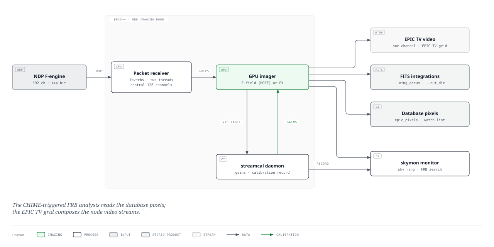
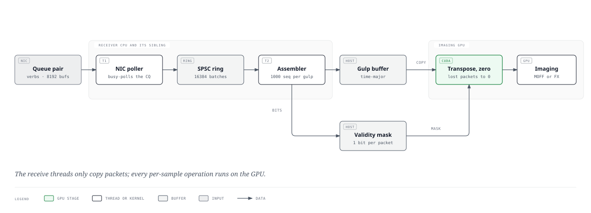
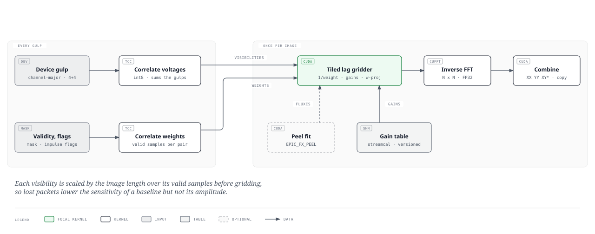
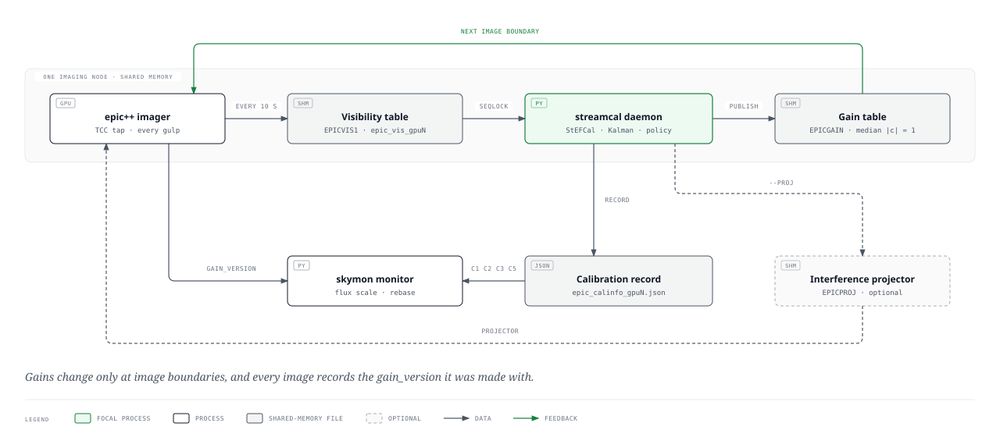

# Design of the EPIC imaging pipeline at LWA-SV

This document describes the real-time imaging pipeline `epic++` of the E-field Parallel Imaging Correlator (EPIC) at the Long Wavelength Array station at Sevilleta (LWA-SV), from the multicast packets of the NDP F-engine to the products derived from the images: FITS integrations, pixels of watched sources in the database, live video, the all-sky transient monitor and the streaming calibration loop that feeds gains back to the imager.

Scope and sources. The description follows branch `phoenix-fx` of the LWA_EPIC repository at commit `b67ed6b`. Every statement is taken from the code; file references are relative to the repository root, and option defaults are those of `src/ex/option_parser.hpp` unless stated otherwise. Deployment settings (the options with which each node is started, the Nomad jobs) are kept outside the repository and are referred to only by the options they set. Two subsystems have documents of their own, which this one summarises and links:

- the all-sky monitor: [skymon: design of the real-time all-sky FRB monitor](../skymon/DESIGN.md), with its calibration interface in [What the all-sky monitor needs from the streaming calibrator](../skymon/streamcal-interface.md);
- the streaming calibration: [Streaming calibration for the EPIC imager](../streaming_calibration/README.md), in particular [section 4, Implementation](../streaming_calibration/04_implementation.md).

---

## 1. Overview



*Figure 1. Data flow on one imaging node. The packet receiver and the GPU imager form one process, `epic++`; the streamcal daemon and the all-sky monitor are separate processes on the same node that exchange data with it through shared memory. PNG: [figures/pipeline-overview.png](figures/pipeline-overview.png).*

Each of the six imaging nodes (`epic1`–`epic6`) receives one NDP stream and images it on one GPU. Within `epic++` the work is a RaftLib graph of kernels (`src/raft_kernels/`), one sub-graph per GPU (`EPIC<N>` in `src/raft_kernels/epic_executor.hpp`, for one to three GPUs; `--ngpus`):

```
packet receiver ──> correlator (GPU imager) ──> channel reducer ──> pixel extractor ──> accumulator ──> disk saver (FITS)
                          │                          │                     └──> database ingester (epic_pixels)
                          │                          ├──> sky ring (all-sky monitor)
                          │                          └──> index fetcher ──> pixel extractor (watch-list indices)
                          └──> live streamer (video)
```

The correlator kernel (`src/raft_kernels/correlator.hpp`) owns the GPU. It images every gulp of voltages with one of two methods, the E-field gridding of the original EPIC design (MOFF) or an FX route through the Tensor-Core Correlator (`--imager epic|fx`, default `epic`), applies the calibration gains of the streamcal daemon at image boundaries and hosts the GPU calibration tap. The graph downstream of the correlator is the same for both methods.

---

## 2. Input: the NDP F-engine streams

The NDP F-engine sends each stream as UDP multicast (`--addr`, `--port`; one address and port per GPU). A packet carries a 32-byte big-endian header (`snap2_hdr_type`, `src/ex/formats.h`: sequence number, sync time, `npol` = 32 inputs, `npol_tot` = 512, `nchan`, `nchan_tot`, `chan_block_id`, `chan0`, `pol0`) and `nchan × 32` bytes of 4+4-bit complex samples, the real part in the high nibble. A sequence is one spectrum of 8192 samples at 196 MHz, 41.8 µs, and a channel is 196 MHz / 8192 = 23.93 kHz wide (`src/ex/constants.h`).

A stream of 192 channels arrives as two blocks of 96 channels from each of 16 boards, 32 packets per sequence. The packet processor (`src/ex/packet_processor.hpp`) checks every header (32 inputs per packet, 512 in all, the payload size, `nchan_tot = 2 nchan`, the block index and the input offset) and keeps only the central `NDP_NCHAN_SELECT` channels of the stream: channels `(nchan_tot − NDP_NCHAN_SELECT)/2` onwards, that is channels 32–159 of 192 for the default selection of 128. The selection is fixed at build time (CMake `EPIC_NCHAN_SELECT`, 128 by default, 192 possible); the first absolute channel of the kept band is recorded as the gulp's `chan0`. The E-field path images at most 128 channels; the FX path images all selected channels.

---

## 3. Packet receiver



*Figure 2. The two receive threads, the gulp buffer and the validity mask on the host, and the first GPU stage. PNG: [figures/pipeline-receiver.png](figures/pipeline-receiver.png).*

### 3.1 Verbs receive and the two threads

Packets are received with ibverbs on a raw packet queue pair (`src/ex/bf_ibverbs.hpp`); the Ethernet, IP and UDP headers (42 bytes) are stripped by offset. The receive queue has `EPIC_VERBS_NPKTBUF` packet buffers, a CMake setting (8192 by default, about 11 ms of a 192-channel stream).

With `EPIC_RECV_THREADS` unset or at least 2 (the default), reception runs on two threads connected by a single-producer, single-consumer ring of 16 384 packet batches with head and tail on separate cache lines:

- the **NIC poller** busy-polls the completion queue, without completion events or interrupts, and pushes each batch of completions into the ring;
- the **assembler** takes batches from the ring, copies each packet into its gulp and returns the buffers to the receive queue once a batch is consumed.

The assembler is pinned to the receiver CPU and the poller to its hyperthread sibling. `EPIC_RECV_THREADS=1` selects the single-threaded receive path, which waits on the completion channel.

### 3.2 CPU reservation

The receiver CPU and its sibling are reserved for the two receive threads (`src/ex/cpu_reserve.hpp`). The receiver CPU is the first CPU of the GPU's block in the kernel layout (`--cpu_layout`: `wide` places GPU g's kernels on CPUs 9g+3 to 9g+11, `compact` on 5g+3 to 5g+7; `src/raft_kernels/epic_executor.hpp`). After the reservation the main thread moves to the remaining CPUs of the process, and every helper thread started later does the same: the OpenMP threads of the set-up code (`src/ex/par_helpers.hpp`) and the publisher thread of the GPU calibration tap. Benchmark and offline runs make no reservation.

### 3.3 Time-major gulp assembly

A gulp holds 1000 sequences, 41.8 ms of data (`src/ex/packet_assembler.hpp`); the assembler keeps a pool of 100 page-locked gulp buffers. The first gulp starts at a gulp boundary about one second after start-up, computed from the absolute sequence number, so that every instance uses the same gulp boundaries. Each packet is copied whole into its sequence row: the gulp is assembled time-major, `[sequence][channel][board][32 inputs]` (metadata `data_order = "t_maj"`), so that the copy of a packet is one contiguous write. The reordering to channel-major order, which a per-packet scatter could not sustain at the packet rate of a 192-channel stream, is done on the GPU (section 4).

A packet that arrives a full gulp or more ahead of the gulp being filled closes that gulp and moves the assembler to the packet's gulp. A gulp with fewer than half of its packets (`ALLOWED_PKT_DROP`, 50%) is not passed on.

### 3.4 Validity mask

For every gulp the assembler records which packets arrived: one bit per source (board and channel block, 32 sources) and sequence. A source that delivered fewer than half of its packets in the gulp is marked invalid as a whole. The receive threads do not zero the samples of lost packets; the mask goes with the gulp as metadata (`valid_mask`, with `valid_block`, the channel block of each gulp channel), together with the gulp's `data_quality` (the fraction of packets received) and the valid fraction of each source.

---

## 4. GPU front end

For each CUDA stream (`--nstreams`, default 8, each holding a share of the channels) the correlator copies the stream's channel columns of every sequence row from the pinned gulp to a staging buffer (`cudaMemcpy2DAsync`) and transposes them on the GPU into the channel-major device gulp `[channel][sequence][stand][polarisation]` (`TimeToChanMajor`, `src/MOFF_cu_handler.cu`). `ZeroLostPackets` then zeroes the 32 samples of every (channel, sequence, board) whose packet is missing in the validity mask. The masks reach the GPU through a ring of eight mapped page-locked slots. Lost samples therefore enter the imaging as zeros, never as stale data from an earlier use of the buffer, and the mask is also used to weight the FX visibilities and the calibration tap (section 5.3).

**Interference stage (optional).** With `--proj_table` (an interference projector published by streamcal) or `--impulse_sigma S` > 0, an `RfiStage` (`src/ex/rfi_stage.cu`) runs after the copy. It projects every voltage vector as x − Ũ(Ṽᴴx), with at most four components per polarisation, re-quantises to 4+4 bits with dither into a second buffer, and zeroes the sequences whose band power within a stream exceeds the gulp median by S robust standard deviations (`median + S × 1.4826 × MAD`). With a Sun vector in the projector the Sun's share of the power is removed before the test, so solar bursts are not zeroed. The raw gulp is left unchanged, so the calibration tap correlates unprojected voltages. The stage is off by default, and the image metadata `proj_version`, `proj_q` and `impulse_flag_frac` are written only when it is configured. Its design is in [section 10.8 of the streaming calibration notes](../streaming_calibration/10_real_data_methodology.md).

---

## 5. Imaging

### 5.1 Array geometry

The geometry is computed in Python (`src/python/epic_geometry.py`, called through pybind11 from `src/ex/py_funcs.hpp`) for every spectral window and cached on disk (`EPIC_GEOMETRY_CACHE`, default a directory under `/var/tmp`; empty disables the cache). The cache key is a SHA-256 hash of the inputs, and a cached file is used only if its arrays match exactly.

- **Phase centre.** With `EPIC_PHASE_CENTER=plane` (the default) the images are phased to the normal of the plane fitted to the used stands (azimuth about 124.6°, elevation about 88.19°), and the grid axes lie in that plane; `zenith` restores the zenith phase centre. The stands' heights above the plane (w) are taken relative to their median.
- **Phases.** `epic_utils.gen_phases_lwasv` gives each stand and polarisation the cable delay minus the geometric delay of the phase centre, divided by the square root of the cable gain; stands flagged in the station's status, and a fixed list of stands, are set to zero.
- **W-projection.** With `--wproj`, each stand's gridding kernel is multiplied in the aperture's Fourier domain by the w-term of its height, `exp(−2πi w (n − 1)/λ)`, truncated to the kernel support and renormalised (`wproj_kernel_weights`).
- **Gridding correction.** The image is divided by `1/|mean_a FT(K_a)|²` of the stands' kernels including their sub-cell offsets (`gridding_correction`); `EPIC_GCF_CORRECTION=legacy` restores the earlier average-kernel correction.

### 5.2 E-field path (MOFF)

With `--imager epic` the voltages are gridded and transformed in a single kernel (`BlockEpicImager`, `src/ex/fft_dx.cuh`): one thread block per channel grids the dual-polarisation voltages of each sequence with the stands' kernels, applies a half-precision 2-D inverse FFT (cuFFTDx, 64 × 64 or 128 × 128 pixels), and accumulates XX, YY and the real and imaginary parts of XY* on chip before writing the image times the gridding correction. Images of up to 128 × 128 pixels are possible; the image covers `--imageres` degrees per pixel (1.0 by default). With `--accum_16bit` the on-chip accumulation is in 16-bit floating point and each gulp is imaged in launches of `--seq_chunk` sequences (100 by default in that mode), because the 16-bit sum loses precision over long runs.

**Autocorrelation removal** (`--remove_autocorr`, off by default). The image of the voltages contains each stand's power convolved with the autocorrelation of its kernel, a smooth positive background. The kernel accumulates each stand's power per sequence and, at the end of the gulp, grids `P_a |g_a|² A_a` around the origin, transforms it once more and subtracts it (Thyagarajan et al. 2017, section 3.2).

### 5.3 FX path



*Figure 3. The FX path: correlation of voltages and sample weights for every gulp, then gridding, transform and combination once per image. PNG: [figures/pipeline-fx.png](figures/pipeline-fx.png).*

With `--imager fx` (`src/ex/fx_imager.cu`; requires a build with `-DEPIC_TCC_ROOT`, `--support 5` and an image size of 128 or 256) the image is formed from visibilities. The FX image is mathematically the E-field image: the gridded cross-correlation of two stands' kernels applied to their visibility equals the cross term of their gridded voltages.

1. **Correlation.** The ASTRON Tensor-Core Correlator (`tcc::Correlator`, int8 input) correlates the 4-bit samples of every gulp, sign-extended to int8, into int32 visibilities of all 32 896 stand pairs including autocorrelations, for all four polarisation products. The correlation accumulates over the gulps of one image.
2. **Sample weights.** The validity mask, the sequence count and the impulse flags of the interference stage form an int8 weight stream (1 for a valid sample, 0 otherwise) per input, which the same correlator correlates like the voltages. The result is, for every pair and polarisation product, the number r of sequences in which both samples were valid. Every visibility is scaled by `n_img / r` (zero for r = 0), so it is normalised by the pair's average weight and rescaled to the image's sequence count: a lost packet lowers the sensitivity of the pairs it touches but not their amplitude. `EPIC_FX_WEIGHTS=0` disables the weighting.
3. **Gains.** The calibration gains are folded into the per-stand phases (section 6) and applied to each pair inside the gridder as `g_{p,a} conj(g_{q,b})`; a stand whose gains are zero is skipped.
4. **Peeling (optional).** With `EPIC_FX_PEEL` set (and not `0`), the bright compact sources above 10° elevation (at most five of Cyg A, Cas A, Tau A, Vir A and the Sun; positions from `src/ex/sky_sources.hpp`, with a low-precision solar ephemeris good to about 0.01°) are fitted and subtracted. One block per channel and polarisation accumulates the normal equations of the source fluxes over the calibrated, weight-normalised cross-correlations on baselines of at least `EPIC_FX_PEEL_UMIN` wavelengths (4 by default), solves them, and the gridder subtracts the modelled visibilities of the fitted fluxes from XX and YY; the cross-polarisation products are not peeled. Peeling is off by default: its effect on the noise of the transient search has not been demonstrated.
5. **Gridding.** The tiled shared-memory lag gridder (`GridLagsTiled`) grids each pair's visibility with the cross-correlation of the two stands' kernels, a 9 × 9 lag footprint for support 5, tabulated once per geometry (`ctab`, float by default, half precision with `EPIC_FX_CTAB=half`) and so including the w-projection of each stand when `--wproj` is set. The grid is divided into tiles of 32 × 32 cells; one block of 256 threads sums the pairs that touch a tile in shared memory and writes the tile whole, so the grid needs no clearing and no global atomic operations. The per-tile pair lists are built on the host for each geometry. `EPIC_FX_GRIDDER=atomic` selects the earlier gridder with global atomic additions. Autocorrelations are gridded unless `--remove_autocorr` is set, in which case the pairs a = b are skipped.
6. **Transform and combination.** cuFFT transforms the four lag grids (N × N, single precision, inverse). XX = 2 Re F(L_XX), YY = 2 Re F(L_YY) and XY* = F(L_XY) + conj F(L_YX) are written in the layout of the E-field images.
7. **Hand-off.** The images are double-buffered on the device and copied to the host while the next image is formed; the correlator passes each image downstream at the next image boundary, so the FX output lags by one image.

With `--sky_shm`, the FX imager also regrids each image on the GPU to the all-sky monitor's HEALPix pixels (bicubic, Keys a = −0.75), from a pixel table the monitor publishes (section 7.6).

### 5.4 Choice of path

| | E-field (MOFF) | FX |
|---|---|---|
| Cost | proportional to the number of sequences | correlation per gulp, gridding and transform once per image |
| Image size | 64 or 128 | 128 or 256 |
| Channels | up to 128 | all selected channels (128 or 192) |
| Kernel support | `--support` (2 by default) | 5 |
| Lost packets | zeroed samples | zeroed samples, visibilities normalised by the valid samples |
| Peeling | no | optional |
| Build | CUDA, cuFFTDx | CUDA, cuFFT, Tensor-Core Correlator |

Both paths target compute capability 8.9 (the RTX 4090 of the imaging nodes); the cuFFTDx kernels of the E-field path are compiled for that architecture only.

### 5.5 Images

An image spans `--seq_accum` milliseconds rounded up to whole gulps. The correlator attaches to it the metadata of its first gulp and `seq_start`, `nseqs`, `img_len_ms`, `grid_size`, `grid_res`, `npols`, `support_size`, `nchan`, `chan0`, a `session_id` that changes with the spectral window, and `gain_version`, the version of the gain table it was made with (0: nominal phases). The binary validity mask is removed from the metadata after use, so it does not reach the FITS headers.

---

## 6. Calibration loop



*Figure 4. The calibration loop on one node. PNG: [../streaming_calibration/figures/streamcal-loop.png](../streaming_calibration/figures/streamcal-loop.png).*

The gains are solved on the host CPUs and applied on the GPU, so that calibration adds nothing to the imaging kernels. The loop has four parts; the formalism, experiments and implementation are in [docs/streaming_calibration](../streaming_calibration/README.md).

1. **Tap.** With `--caltap_gpu` the tensor-core correlator of the tap (`src/ex/tcc_tap.cu`) correlates every gulp from the device copy of the raw voltages, after lost-packet zeroing and before projection, gains or impulse flags, on its own CUDA stream. Gulps with less than `--caltap_min_quality` (0.98) valid data are skipped. After `--caltap_interval` seconds of F-engine time (10 s) the XX and YY covariance of all channels, `R = Σ x xᴴ / n`, is published under a sequence lock to the visibility table `--caltap_out` (`/dev/shm/epic_vis_gpu{gpu}`, layout `EPICVIS1`, `src/ex/vis_table.hpp`). In an integration in which packets were lost the tap correlates the sample weights as well, from the first lossy gulp on, and divides each product by its own number of valid samples. A CPU tap on a slice of each gulp (`--caltap_nseq`, `src/ex/cal_tap.hpp` with the AVX2 X-engine of `src/ex/xengine.hpp`) reads channel-major gulps only and is therefore not used with NDP data.
2. **Solution.** The streamcal daemon (`python -m streamcal.daemon`, `src/python/streamcal/`) fits each table with StEFCal against a forward model of the sky (A-team, diffuse sky and Sun through the dipole beam), solves the fluxes and positions of the bright sources together with the gains, rejects channels with excess χ², tracks phase and delay per stand with a Kalman filter and averages the amplitudes. The model is interpolated between snapshots a minute apart.
3. **Publication.** The daemon publishes relative corrections (median |c| = 1 per channel and polarisation, with noise-optimal weights) to the gain table `/dev/shm/epic_gains_gpu{gpu}` (`EPICGAIN`). After a warm-up of 300 s a table is published only when it changes the phases by more than 1°, the brightness of a compact source or the diffuse sky by more than 0.1%, the amplitudes by more than 2%, or the flags, or when the last table is 600 s old. With every published table the daemon writes the calibration record (`--calinfo`), which gives the all-sky monitor the absolute flux scale that the relative table removed.
4. **Application.** At the first gulp of every image the correlator polls the gain table (`--gain_table`, `src/ex/gain_table.hpp`). A table is accepted if its version is newer, its `valid_from_seq` has passed, it covers the imaged channels, its values are finite and at most 64 in magnitude, and its median |c| lies in 0.25–4. It is multiplied into the nominal per-stand phases and uploaded to the GPU (`ApplyGainTable`), so every image is made with exactly one table, whose version is the image's `gain_version`. A change of spectral window resets the reader and returns to the nominal phases.

The publication policy, the model interpolation and the calibration record are described in [section 4.4 of the streaming calibration notes](../streaming_calibration/04_implementation.md#44-streamcal-python).

---

## 7. Outputs

### 7.1 Channel reduction

The channel reducer (`src/raft_kernels/chan_reducer.hpp`) sums `--chan_nbin` adjacent channels (4 by default) for the products downstream of it, sets `nchan` and `chan_width` accordingly, and drops empty images and images of health-check frequencies. It also publishes every image to the all-sky monitor's ring (section 7.6), at full channel resolution or binned by `--sky_nbin`.

### 7.2 FITS integrations

The accumulator (`src/raft_kernels/accumulator.hpp`) sums `--nimg_accum` images (1 by default) into one integration. A change of `chan0`, or a gap of more than `--accum_max_gap` images (48), ends the sum; a partial sum is written if it holds at least `--nimg_accum_min` images (by default 10% of `--nimg_accum`), with `NIMGACC` recording the number of images summed. The disk saver (`src/raft_kernels/disk_saver.hpp`) queues each integration for a writer thread (queue of four; a full queue drops the integration with a rate-limited log). The writer thread hands it to a Python writer in a process of its own (`src/ex/fits_writer_proc.hpp`, `src/python/epic_fits_writer.py`), which epic++ starts at the first integration and restarts if it dies; the embedded interpreter's lock is shared by every stage that calls into Python, and a 192-channel integration (201 MB) written from inside epic++ held it for about two seconds, during which the pixel extractor stopped and the correlator ran out of output buffers. `EPIC_FITS_WRITER=inproc` restores the in-process writer, and `EPIC_PYTHON` names the interpreter (`python3` by default). The writer calls `epic_utils.save_output`:

- the file is `<out_dir>/YYYYMMDD/EPIC_<mid time>_<centre frequency>MHz.fits`, the day being the UTC day of the integration's middle, written under a temporary name and renamed when complete;
- the primary header holds the image metadata, `DATE-OBS`, `DATE-BEG`, `DATE-END` and `NIMGACC`; the data unit holds `[4 polarisation products][channel][y][x]` with the celestial WCS of `epic_geometry.apply_wcs`;
- a quick-look PNG is written beside it, the file is registered in `epic_files_metadata2` of the node database, and `daily_digest.py` records the Stokes I and V spectra of the watched sources in `epic_daily_digest`.

The FITS archive on the shared file system is curated by `src/python/archive_curator.py` (age limit and file-system ceiling; see [section 5.3 of the skymon design](../skymon/DESIGN.md#53-archive-and-retention)).

### 7.3 Pixels of watched sources

The index fetcher (`src/raft_kernels/index_fetcher.hpp`) asks `src/python/pixel_extractor.py` every 10 s for the pixels of the watched sources at the current image time. The watch list comes from the watchdog service over gRPC (`--watchdog_addr`), from the table `epic_watchdog` of the head database when `EPIC_WATCH_DSN` is set, or from a cached copy (`EPIC_WATCHLIST_CACHE`). For each source above `--elev_limit_deg` (10°) a square patch of pixels (`patch_type`, 5 × 5 by default) around the source is selected, with its direction cosines and the source's fractional pixel position. The pixel extractor (`src/raft_kernels/pixel_extractor.hpp`) cuts the patches from every image, and the database ingester (`src/raft_kernels/db_ingester.hpp`) writes them in one transaction per image to `epic_pixels` (with `epic_img_metadata2` for the session) in the schema `--epic_data_schema` of the node database (`EPIC_NODE_DSN`, or the libpq `PG*` variables).

### 7.4 FRB analysis triggered by CHIME

Events of the CHIME/FRB VOEvent stream are added to the watch list by the watchdog service as rows of `event_type` `frb`, so that the imager stores the pixels around each burst's position for the watch window. The analysis of these pixels (dedispersion, a DM–time transform, products and notification) is carried out downstream of the imager by the `frb-analysis` job of the Waterfalls backend, outside this repository. The imager has no trigger logic of its own: a triggered source is a watch-list row like any other.

### 7.5 Live video

The live streamer (`src/raft_kernels/epic_live_streamer.hpp`, `src/ex/video_streaming.hpp`) takes every image from the correlator before channel reduction and encodes Stokes I of the first channel as H.264 (10-bit, colour map `--stream_cmap`, frame side `--video_size`, horizon mask, frequency and time label) and sends it over RTMP to `--stream_url`, by default a media server on the same node. The EPIC TV grid on the head node composes the streams of the six nodes with a coordinate grid rendered by `src/python/grid_overlay.py`.

### 7.6 All-sky monitor

With `--sky_shm <name>` the channel reducer passes every image to a `SkyPublisher` (`src/ex/sky_publisher.hpp`), which writes Stokes I (XX + YY) to the next slot of a ring in `/dev/shm/<name>` (`EPICSKY1`, `--sky_shm_slots` 64) under a sequence lock and never waits for the reader. Each slot header carries the image's `gain_version`. With the FX imager and the monitor's pixel table (`/dev/shm/<name>_table`, `EPICSKYT`) the slot holds the pixel spectra regridded on the GPU instead of the image (`layout` 1).

The monitor (`python -m skymon run`, `src/python/skymon/`) tracks every HEALPix pixel above 10° elevation, normalises and excises interference, searches DM 0–3000 pc cm⁻³ with a hierarchical FDMT in octave tiers, classifies and stores candidates in a local database, and fits a burst model (DM, arrival time, intrinsic width, scattering time, spectral index and curvature, fluence) to each candidate's dynamic spectrum (`burstfit.py`). After a change of `gain_version` it holds 24 images and resets every pixel's baseline to their mean before searching them, so a change of calibration is not taken for a broadband pulse. Fluences use the calibrators measured in the images and the calibration record of streamcal. A combiner forms events across bands; an archiver per node copies kept events to the shared archive, and a catalogue in the head database lists FRB events and giant pulses of the Crab pulsar. The design, algorithms and verification are in [skymon: design of the real-time all-sky FRB monitor](../skymon/DESIGN.md).

---

## 8. Configuration

### 8.1 Command-line options of `epic++` that matter for operation

| Option | Default | Effect |
|---|---|---|
| `--addr`, `--port` | `239.168.40.11,239.168.40.12`, `10000,10000` | multicast address and port of the stream, one per GPU |
| `--ngpus`, `--gpu_ids` | 1, automatic | number of pipelines and their devices |
| `--runtime` | 5 | seconds to run; −1 runs indefinitely |
| `--imager` | `epic` | `epic`: E-field (MOFF) kernel; `fx`: Tensor-Core Correlator route |
| `--imagesize`, `--imageres` | 128, 1.0 | pixels per side (64, 128; 256 with FX), degrees per pixel |
| `--channels` | 128 | channels imaged (at most 128 for MOFF, `NDP_NCHAN_SELECT` for FX) |
| `--nts` | 1000 | sequences per gulp |
| `--seq_accum` | 40 | milliseconds per image, rounded up to whole gulps |
| `--support`, `--aeff`, `--kernel_oversample` | 2, `25,16`, 2 | gridding kernel support (FX requires 5), effective area per GPU in m², oversampling |
| `--wproj` | off | w-projection kernels |
| `--remove_autocorr` | off | remove the autocorrelation background (MOFF); skip the pairs a = b (FX) |
| `--accum_16bit`, `--seq_chunk` | off, −1 | 16-bit on-chip accumulation; sequences per launch (−1: 100 in 16-bit mode, else the whole gulp) |
| `--nstreams` | 8 | CUDA streams per GPU |
| `--cpu_layout` | `wide` | CPU placement of the kernels (`wide` or `compact`); sets the receiver CPU |
| `--gain_table` | empty (off) | gain table of streamcal, e.g. `/dev/shm/epic_gains_gpu{gpu}` |
| `--proj_table`, `--impulse_sigma` | empty, 0 (off) | interference projector of streamcal; impulse zeroing threshold |
| `--caltap_gpu` | off | GPU calibration tap (Tensor-Core Correlator) |
| `--caltap_out`, `--caltap_interval`, `--caltap_min_quality`, `--caltap_record_dir` | `/dev/shm/epic_vis_gpu{gpu}`, 10, 0.98, empty | tap table, integration per table (s, at most 600), minimum valid data per gulp, optional copy of every table |
| `--caltap_nseq`, `--caltap_threads`, `--caltap_batch` | 0 (off), 2, 8 | CPU tap (channel-major gulps only) |
| `--vistap` | off | run only the receiver and the GPU tap, for calibration data takes |
| `--chan_nbin` | 4 | channels summed for FITS and database products |
| `--nimg_accum`, `--nimg_accum_min`, `--accum_max_gap` | 1, −1 (10%), 48 | images per FITS integration, minimum of a partial sum, tolerated gap in images |
| `--out_dir` | `./` | root of the FITS files |
| `--sky_shm`, `--sky_shm_slots`, `--sky_nbin` | empty (off), 64, 1 | all-sky monitor ring, its slots, channels summed per published channel |
| `--watchdog_addr`, `--elev_limit_deg`, `--epic_data_schema` | `localhost:2023`, 10, `public` | watch-list service, elevation limit of extracted sources, database schema |
| `--stream_url`, `--video_size`, `--stream_cmap` | `rtmp://127.0.0.1:1857/live/epic`, 512, `magma` | live video |
| `--metrics_bind_addr`, `--disable_metrics` | `127.0.0.1:8080`, off | Prometheus endpoint |
| `--bench` and `--bench_*` | off | benchmark mode with simulated gulps ([section 7 of the streaming calibration notes](../streaming_calibration/07_benchmark.md)) |

### 8.2 Environment variables

| Variable | Default | Effect |
|---|---|---|
| `EPIC_RECV_THREADS` | 2 | 1: single receive thread on the completion channel; 2 or more: NIC poller and assembler |
| `EPIC_PHASE_CENTER` | `plane` | phase centre of the images: `plane` (normal of the array plane) or `zenith` |
| `EPIC_GEOMETRY_CACHE` | a directory under `/var/tmp` | disk cache of the geometry; empty disables it |
| `EPIC_GCF_CORRECTION` | unset | `legacy`: earlier gridding correction |
| `EPIC_FX_WEIGHTS` | on | `0`: no sample-weight normalisation of the FX visibilities |
| `EPIC_FX_PEEL` | off | set and not `0`: peel the A-team and the Sun in the FX path |
| `EPIC_FX_PEEL_UMIN` | 4 | shortest baseline of the peeling fit, in wavelengths |
| `EPIC_FX_GRIDDER` | tiled | `atomic`: gridder with global atomic additions |
| `EPIC_FX_CTAB` | float | `half`: pair-kernel table in half precision |
| `EPIC_GULP_TRACE` | unset | file receiving one line per gulp: sequence, data quality, sources short of packets, smallest valid fraction, sources without packets, gain and projector versions, first gulp of an image |
| `EPIC_NODE_DSN`, `PG*` | libpq defaults | node database; a connection timeout of 5 s is added if none is set |
| `EPIC_WATCH_DSN`, `EPIC_WATCHLIST_CACHE` | unset | watch list from the head database; file cache of the watch list |
| `EPIC_BENCH_TMAJ` | unset | benchmark mode delivers time-major gulps |

Build-time settings: `EPIC_NCHAN_SELECT` (128 or 192 channels kept per stream), `EPIC_VERBS_NPKTBUF` (receive buffers, 8192) and `EPIC_TCC_ROOT` (Tensor-Core Correlator, needed for `--imager fx` and `--caltap_gpu`). The streamcal daemon and the all-sky monitor have their own options, listed in [section 4 of the streaming calibration notes](../streaming_calibration/04_implementation.md) and in [section 7 of the skymon design](../skymon/DESIGN.md#7-operations).

---

## 9. Monitoring

`epic++` exports Prometheus metrics on `--metrics_bind_addr` (`src/ex/metrics.hpp`): the execution time of every kernel, the time of the imaging kernel per GPU, the receiver's data quality, the imaged `chan0`, the pending, dropped and failed rows of the database ingester, and an information metric with every option and the git revision. `EPIC_GULP_TRACE` gives the per-gulp record that separates packet loss from calibration and projector changes in the images. The receiver's statistics include the largest backlog of the receive ring.

---

## 10. Known limitations

- The CPU calibration tap (`--caltap_nseq`) and `--vistap` mode read the host gulp as channel-major. With the time-major NDP gulps the correlator disables the CPU tap with a warning; `--vistap` copies the time-major gulp to the GPU without transposing it, zeroing lost packets or passing the validity mask (`src/raft_kernels/vistap_kernels.hpp`), so tables taken in that mode are not valid for NDP data.
- The GPU tap publishes XX and YY only; the cross-hand phase is left at the cable model.
- Peeling acts on XX and YY only, so the residuals of the peeled sources remain in the cross-polarisation images.
- Several GPUs in one process share one reserved receiver CPU, because the reservation records only the first receiver CPU.
- The receiver takes the gulp length from its own default of 1000 sequences, not from `--nts`.
- The image metadata (`nseqs`, `img_len_ms`) assume that the gulps of an image are contiguous; a gulp dropped for packet loss shortens the span actually imaged.

---

Figures. The figures use the diagram skin of the skymon design ([section 8 of that document](../skymon/DESIGN.md#8-diagram-colours)). The sources are in `figures/src/*.html`; the SVG files are exported without web-font imports and the PNG files are rendered at twice the SVG size with the web fonts.
