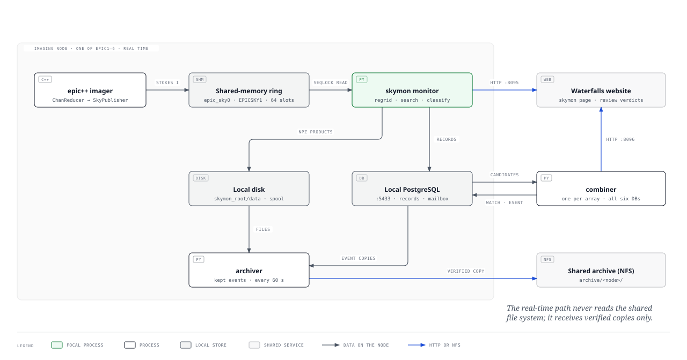
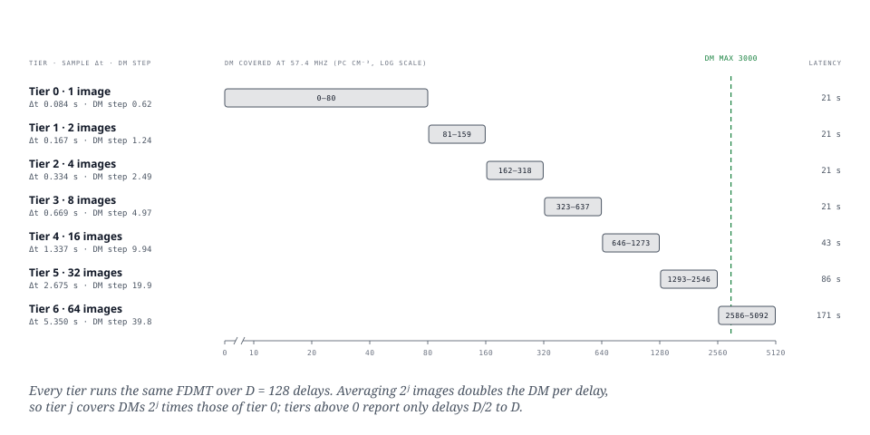
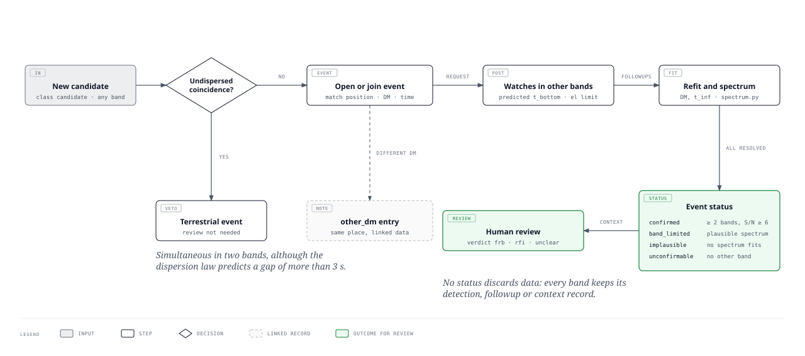
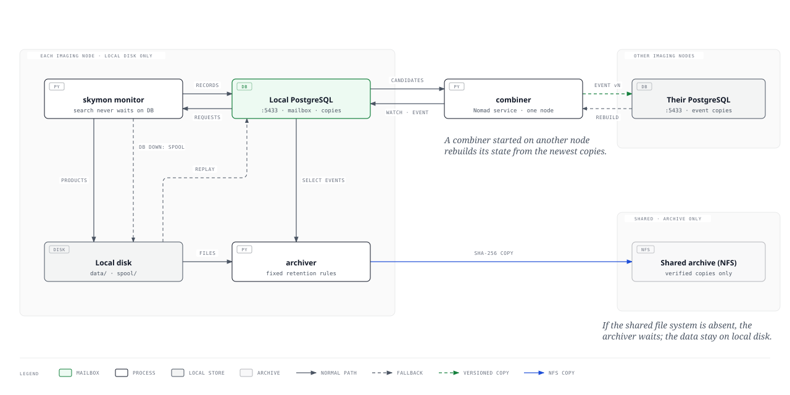

# skymon: design of the real-time all-sky FRB monitor

`skymon` searches every EPIC all-sky image formed at LWA-Sevilleta (LWA-SV) for dispersed radio bursts, at every sky position above the elevation limit, in every imaging band, in real time. This document describes its requirements, architecture, algorithms, storage, calibration interface, operation and verification.

Scope and sources. The description follows the working tree of branch `phoenix-skymon` of the LWA_EPIC repository, at commit `b93e354`. The facts are taken from the package README (`src/python/skymon/README.md`), the module docstrings and code of `src/python/skymon/`, the published page *All-Sky Monitor* of the EPIC documentation (`content/1.docs/3.lwa-sv-imager/6.all-sky-monitor.md` of the Waterfalls site, branch `skymon`), and the Nomad jobs and Ansible playbook of `epic-sv-devops`. Points that these sources leave open or state inconsistently are collected in [Open items](#11-open-items-and-known-limitations).

---

## 1. Purpose and requirements

| # | Requirement | How it is met |
|---|---|---|
| R1 | Search the whole visible sky for dispersed bursts, in every band, in real time. | One monitor per imaging node follows every image of its band (83.6 ms, 128 channels of 24 kHz, 3.06 MHz) and tracks every HEALPix pixel above 10° elevation (about 20 300 pixels at `nside` 64). Processing takes 40% of real time (§10). |
| R2 | Each node works independently. | A monitor depends on no other node, no other monitor, the combiner, the head node or the shared file system. The loss of a node removes only its band. |
| R3 | No data are lost unless they are certainly RFI; a human verifies FRBs. | Only RFI at DM < 2 pc cm⁻³ or triggering more than 1% of the sky at once is stored without data products. Every other candidate, every followup and every context record keeps its data. Every sky event is marked `review: pending`; the verdict (`frb`, `rfi`, `unclear`) is recorded by a person. |
| R4 | The shared file system is an archive only, never in the real-time path. | Code, Python environment, database and data products of each monitor are on the node's local disk. A separate archiver copies kept data to the archive on the shared file system (NFS) when it is mounted and waits otherwise. |

The dispersion delay across a band from $f_\mathrm{lo}$ to $f_\mathrm{hi}$ is

$$
\Delta t = k_\mathrm{DM}\,\mathrm{DM}\left(f_\mathrm{lo}^{-2} - f_\mathrm{hi}^{-2}\right), \qquad k_\mathrm{DM} = 4.1488 \times 10^{3}\ \mathrm{s\ MHz^2\ pc^{-1}\ cm^3}.
$$

At 57 MHz a burst at DM 3000 pc cm⁻³ takes 6.7 min to cross the band; at 16 MHz it takes 5.2 h. These sweep times set the design: the search must follow fixed sky positions for hours, hold its history in memory, and relate detections made hours apart in different bands.

---

## 2. Data flow



*Figure 1. Data flow on one imaging node (shaded zone, the real-time path) and the shared services outside it. PNG: [figures/skymon-dataflow.png](figures/skymon-dataflow.png).*

### 2.1 Publication: epic++ to shared memory

`epic++ --sky_shm epic_sky0` makes the `ChanReducer` raft kernel (`src/raft_kernels/chan_reducer.hpp`) pass every image to a `SkyPublisher` (`src/ex/sky_publisher.hpp`). The publisher writes Stokes I (XX + YY) at full channel resolution into the next slot of a ring in the shared-memory segment `epic_sky0`. The pixel order is that of the saved FITS images, `[chan][y][x]`, so the monitor uses the imager's own WCS (`epic_geometry.apply_wcs`) unchanged.

The ring layout `EPICSKY1` (version 1, little endian) is shared by the C++ writer and `shm.py`:

| Offset | Type | File header (4096 bytes) |
|---|---|---|
| 0 | `char[8]` | magic `EPICSKY1` |
| 8 | `u32` | version (1) |
| 12 | `u32` | `nslots` |
| 16 | `u64` | `slot_bytes` |
| 24 | `u64` | `data_offset` (4096) |
| 32 | `u32` | `max_nchan` |
| 36 | `u32` | `max_grid` |
| 40 | `u64` | `write_count`, images completed since the writer started |
| 48 | `u32` | writer PID |
| 56 | `u64` | `session`, changed when the writer restarts |

| Offset | Type | Slot header (256 bytes), followed by `f32 data[nchan][grid][grid]` |
|---|---|---|
| 0 | `u64` | lock: 2n + 1 while image n is written, 2n + 2 once complete |
| 8 | `u64` | `seq_start`, NDP sequence of the first spectrum |
| 16 | `u32` | `nseqs` |
| 20 | `u32` | `chan0`, absolute NDP channel of data channel 0 |
| 24 | `u32` | `nchan` |
| 28 | `u32` | `nbin`, NDP channels summed per data channel |
| 32 | `u32` | `grid` |
| 36 | `u32` | phase-centre mode (0 plane, 1 zenith) |
| 40 | `f64` | `grid_res` (deg) |
| 48 | `f64` | `img_len_ms` |
| 56 | `u64` | `gain_version`, version of the calibration gain table the image was made with (0: nominal phases) |

The lock word is a sequence lock. The reader accepts slot n only if the lock reads 2n + 2 before and after the copy; a different value means the slot was overwritten and the image is counted as lost. The writer never waits: a reader more than `nslots − 1` images behind skips to the oldest safe slot and counts the drop, and a change of `session` (or a fall of `write_count`) resets its position. A restart of either program therefore never stalls the other. The default ring holds 64 images (5.3 s at 83.6 ms, 537 MB for 128 channels of 128 × 128 pixels; 2.7 s and 3.2 GB for the FX imager's 192 channels of 256 × 256 pixels).

### 2.2 The monitor

`monitor.py` processes the images in time order. A missing image is searched as zeros, so the time axis stays regular; a gap longer than 60 s (`max_gap_s`) restarts the search state.

1. **Sky-fixed pixels** (`geometry.py`). The monitor tracks HEALPix pixels (J2000, RING order) rather than image pixels, so that each time series looks at one patch of sky for the hours a sweep can last. Every 10 s the tracked set is recomputed: a pixel that rises above the elevation limit (10°) receives a slot in the state arrays, a pixel that sets releases it. Between updates the image position of each pixel is interpolated linearly in time.
2. **Regridding.** Each image is interpolated onto the tracked pixels by bicubic convolution (Keys 1981, 16 taps, a = −0.75).
   - The beam spans about three image pixels across its FWHM. At that sampling, bilinear interpolation loses 10% of a source's peak on average (up to 15%), and the error ripples in all channels at once as the sky turns.
   - Keys' usual a = −0.5 loses 2.5% on average (up to 4.8%).
   - a = −0.75 reproduces the peak to between 0.0% and +0.8% (+0.4% on average), with no additional taps. In exchange, a plane is no longer reproduced exactly: a gradient of g per image pixel is offset by at most 0.048 g. This is a slow ripple of smooth emission as the sky turns, which the running mean, high-pass and detrend remove.
   - These figures come from a Gaussian beam at 1500 random positions.
3. **Resolution.** `nside` is the coarsest at which a pixel is no larger than half the synthesised beam λ/D (D ≈ 100 m), and never finer than an image pixel: 64 (0.92°) above 40 MHz, 32 near 35 MHz, 16 at 16–21 MHz.
4. **Normalisation, flagging, tiers, search and classification** (§3).
5. **Products** (`candidates.py`, `accumulate.py`). Each candidate is a JSON record and, unless it is certain RFI, an `.npz` file under `<out>/candidates/YYYYMMDD/` holding the pixel's dynamic spectrum at the tier's resolution, its DM–time plane, 30 min of accumulated spectrum before the burst, the noise table, and the calibration data of §6. The raw spectrum of every tracked pixel, averaged over 10 s, is kept for 6 h in float16 (12 GB at `nside` 64) and serves the spectrograms of the website.
6. **Conditions** (`conditions.py`, §4.6) and **live test injections** (`inject.py`, §7.3).

### 2.3 Beyond the monitor

| Component | Role |
|---|---|
| Local PostgreSQL (port 5433) | Record of every candidate; mailbox between monitor and combiner; copies of events (§5). |
| Local disk (the node's local data directory under `skymon_root`) | Data products, spool of records while the database is unavailable. |
| Combiner (`combiner.py`, port 8096) | One process for the array, on any imaging node. Reads new candidates from every node's database every 10 s, forms events across bands (§4). |
| Archiver (`archiver.py`) | One per node. Copies kept candidates and events to the archive on the shared file system (`--archive`, subdirectories `<node>/YYYYMMDD/`), applies local retention (§5.3). |
| Website | The Waterfalls backend (`server/backend/app/api/routes/skymon.py`) queries every monitor on :8095 and the combiner on :8096, and forwards review verdicts. The page is `/waterfalls/spectrograms/skymon`. |

---

## 3. Search

### 3.1 Normalisation and interference excision

For each image the regridded values `[chan, pixel]` are processed by `skymon_normalise` (`_kernels.c`) and `search.py`:

| Step | Operation | Parameters (defaults) |
|---|---|---|
| Running mean | Exponential moving average per pixel and channel. | `norm_tau_s` 120 s |
| Running variance | Half the mean square of successive differences, which a slow change of brightness (a source rising through the primary beam) does not inflate. Deviations are limited to 5σ before entering the statistics. | `var_tau_s` 300 s |
| Common mode | The median over the tracked sky of each channel is subtracted. Sidelobe RFI and gain changes affect the whole image; a burst occupies one beam and leaves the median unchanged. | |
| Channel flagging | After the median, the spread of each channel over the sky, 1.4826 × MAD over a subset of up to 2048 pixels, is about 1 for noise. A channel whose spread exceeds `chan_flag_sigma` times that of the band (the median spread over channels, or 1 if smaller) is zeroed for every pixel of that image. A carrier scattered over much of the sky (aircraft, meteor trail) widens one channel; a burst does not. A rise of noise over the whole band widens every channel alike and is not flagged, but is recorded in the conditions. | `chan_flag_sigma` 1.6 |
| Persistent mask | A channel whose flag rate (exponential, 30 s) exceeds 0.5 is zeroed in every image until the rate falls below 0.2. | `flag_tau_s` 30, `mask_on` 0.5, `mask_off` 0.2 |
| Cell clip | A single cell (pixel, channel) beyond 12σ is zeroed unless it is sky-shaped, that is, at least 3 of its 8 HEALPix neighbours deviate the same way by at least 0.3 of its deviation, in the same channel and image. | `clip` 12, `clip_sky_neighbours` 3, `clip_sky_fraction` 0.3 |

**Why the clip has a sky-shape exemption.** A burst of S/N s whose signal in a channel falls into one image adds s √(n_eff / N_c) to that cell. Here n_eff, about 1.7 at the top of a tier, is the number of samples per channel in the definition of the S/N, so the clip is reached at S/N 73 for 64 channels, at 104 for 128 and at 127 for 192.
- **Without the exemption,** a burst of S/N 120 in 64 channels lost the cells of its core pixels. It was found 1.5° away, at S/N 54, with 0.45 of its fluence.
- **Raising the clip with the number of channels** only moves the limit: any fixed threshold removes the brightest bursts.
- **The exemption keeps the clip's protection.** Anything from the sky reaches the image through the synthesised beam, which is wider than a sky pixel (pixels of at most half the beam), so a neighbour sees 0.5–0.8 of a point source's peak. A cell beyond the clip whose neighbours do not follow is not of sky origin and is still zeroed.
- **Kept cells do not update the statistics.** A cell beyond the clip, kept or not, is withheld from the running statistics.
- **Narrowband interference that passes.** A point-like carrier in a few channels can pass the exemption. It is then classified as narrowband interference by its effective number of channels (§3.4), with its data kept.

With the exemption, bursts of S/N 120 are found at their position (fitted 0.04° from the truth), at 0.87 of the target S/N, with their full fluence.

Flagged channels and cells beyond the clip do not update the running statistics, except that a cell withheld for 30 s in succession updates them again with its deviation limited to 5σ, so that a lasting change of level is followed. `/api/status` reports `rfi_flagging` (fraction zeroed over the last minute, masked channels, flags per channel); each candidate carries `quality.flagged_fraction` along its sweep.

### 3.2 Hierarchical dedispersion in octave tiers



*Figure 2. DM coverage of the seven tiers for the 55.88–58.94 MHz band. Values from the published tier table; latency is the delay between a burst's arrival and its report. PNG: [figures/skymon-tiers.png](figures/skymon-tiers.png).*

The smearing within a channel is the sweep across the band divided by the number of channels N_c. The search (`dedisp.py`, `search.py`) uses this in tiers:

- tier j averages 2^j images (each tier passes the sum of every two inputs to the next, after a high-pass whose time constant is at least `hp_tau` = 32 of its own samples and at least `hp_factor` = 4 times the tier's widest boxcar: 512 samples in tiers 0–4 and 32 above with the default boxcars of §3.3);
- each tier runs the fast dispersion measure transform (FDMT; Zackay & Ofek 2017) over delays 0..D samples, D = N_c (`--max-delay-factor` 1) or 2N_c (factor 2, the setting at 41.8 ms images);
- the delay is linear in DM, so every tier uses the same delay table and tier j covers DMs 2^j times those of tier 0;
- tiers above 0 report only delays above D/2, so the tiers together cover 0–`dm_max` (3000 pc cm⁻³) in octaves;
- at the top of each tier a pulse spans about one sample per channel, so further averaging would lose signal.

Each tier holds only D + block samples of history (block 256 tier-0 samples by default), independent of DM. For 128 channels the search state takes about 0.7 MB per pixel, 14 GB for the sky at `nside` 64. Storing the full-resolution series instead would take 222 000 samples per channel at 16 MHz and DM 3000, about 1 TB for the sky. The histories are kept in IEEE half precision (`--history-dtype float16`, the default): every sum of the transform, the trend and the boxcars is formed in single precision, and a stored sample carries a relative rounding error of at most 2⁻¹¹ against unit noise, which changes a burst's S/N by less than 0.1% (`test_skymon`). For 192 channels with D = 2C and a tier-0 block of 512, the search state takes 1.3 MB per pixel, 26 GiB for the sky at `nside` 64 (51 GiB in single precision).

**Any number of channels.** The transform merges adjacent subbands in pairs. When a level has an odd number of subbands, its lowest subband is passed on unmerged and joins one level later; it has the most delays of the level, so passing it on saves the most work. The delays of every merge are split in proportion to the dispersion delays of its two halves, whatever their widths, so the transform is exact to the same rounding of delays as with a power of two. The 192 channels of an NDP stream form three subbands of 64 channels, of which the upper two are merged first and the lowest joins them in the last merge. Nothing is padded: the transform, the trend, the zero-DM filter and the noise see the 192 channels only, and the band edges are the real ones. The kernel and the numpy transform agree bit for bit for any number of channels, and a dispersed pulse keeps the same fraction of its fluence in 192 channels as in 128 (`test_skymon`).

The search kernel (`skymon_search` in `_kernels.c`) is limited by memory traffic rather than by arithmetic. Each thread transforms a tile of 16 pixels depth first: a subband is merged as soon as both its halves exist, so that the subbands of the lower merge levels stay in the core's cache, and the final merge forms one delay row at a time in a buffer that the boxcar search reads at once. Only the rows and samples that the boxcars read are formed. Above tier 0 only delays above D/2 are reported: the delays of both halves of a merge are non-decreasing in the merged delay, so each subband needs one contiguous range of its rows, those its parent reads, which is about half of them at every level. In time, the boxcars read a final row from the first sample of the widest boxcar ending in the block on; a merged row at sample t reads its lower half at t and its upper half d_lo samples earlier, so each subband is formed from the first sample its parent reads. The sums that are formed are those of the full transform, term by term. The per-image steps (bicubic taps, normalisation and the pushes into the tiers) are compiled as well, and a searched window is moved forward in parallel over channels. Beyond about 12 threads the threads compete for memory bandwidth and the search gains no further speed (§10.1b).

| Tier | Sample (s) | DM range at 57.4 MHz | DM step | Latency (s) |
|---|---|---|---|---|
| 0 | 0.084 | 0–80 | 0.62 | 21 |
| 1 | 0.167 | 81–159 | 1.24 | 21 |
| 2 | 0.334 | 162–318 | 2.49 | 21 |
| 3 | 0.669 | 323–637 | 4.97 | 21 |
| 4 | 1.337 | 646–1273 | 9.94 | 43 |
| 5 | 2.675 | 1293–2546 | 19.9 | 86 |
| 6 | 5.350 | 2586–5092 | 39.8 | 171 |

A tier begins reporting once its window has filled twice: about 21 s for tier 0 and 8.5 min for tier 5 after a monitor starts. A burst whose sweep ends after its position has set cannot be completed: above 30 MHz nearly every visible position stays up long enough for DM 3000; at 16–21 MHz positions near the western horizon limit the reach to a few hundred.

### 3.3 Detection

Before each transform, the mean over the window (D + block samples, or a longer history set by `--detrend-len` and `--detrend-factor`) is subtracted from every channel of every pixel (`--detrend mean`, the default); a pulse of w samples loses w/W of its signal for a window of W samples. The alternative, a straight line fitted over the window (`--detrend linear`, the default before the wide-pulse search), takes up to 4w/W from a pulse at the end of the window, where the search looks: in the tiers with a block of 32 samples it removed most of any pulse wider than about 20 samples. The tier high-pass turns a slow ramp into a constant offset, which the mean removes. Above tier 0 the mean over channels at each time is also subtracted (zero-DM filter; Eatough et al. 2009), which removes gain variations and the residual interpolation ripple of bright sources. A pulse of w samples in a tier whose sweep spans S samples (D/2 ≤ S ≤ D above tier 0) loses about w/S of its signal to this filter; a pulse longer than its sweep is removed almost entirely, so a higher tier cannot recover a wide burst at low DM. Tier 0 is not zero-DM filtered, so that low-DM bursts and pulsars keep their full signal.

**Boxcars.** Tiers 0–4 search boxcars of 1, 2, 4, …, 128 samples and the tiers above 1, 2, 4 and 8 (`--widths`, a list for every tier or per tier range, such as `0-4:1,2,4,8,16,32,64,128;5-:1,2,4,8`). Tiers 0–4 hold DM up to 1450–2900 pc cm⁻³ at 57–76 MHz. A boxcar of w ≥ 16 samples is evaluated at every (w/8)-th end sample (`--boxcar-stride` 8), which costs a matched pulse at most 1/16 and on average 1/32 of its S/N and makes the wide boxcars nearly free. A boxcar is at most D + 1 samples long; wider ones are left out (in test bands with few channels). The widest boxcar is 5.4 s in tier 0 and 86 s in tier 4 at 41.8 ms images. The noise of every delay row and boxcar width is measured from the data, as the clipped RMS of the previous blocks, so the S/N does not assume white noise.

**Threshold.** `--threshold` (S/N 8) is the threshold of the reference search (boxcars 1, 2, 4, 8 in every tier). The threshold applied keeps its Gaussian false-alarm rate (`search.far_threshold`), counting each width w as w⁻¹ of an independent trial per delay row and sample. The wide boxcars add 6.2% to the trials, and the threshold rises from 8.000 to 8.007. On white noise through the whole chain the wide boxcars are so correlated with the narrower ones that the measured rate of segment maxima above S/N 4.5 changed by a factor of only 0.97–1.02 (a threshold of 7.996–8.002), so the model errs on the safe side (§10.1c). Real noise at widths of seconds to a minute (scintillation of the bright sources, gain steps) is not white; its level is recorded in the conditions (§4.6). `--no-far-match` applies `--threshold` unchanged.

### 3.4 Clustering and classification

Hits are clustered over the sky (twice the beam width, widened towards the horizon), over DM and over time; each cluster becomes a candidate at its brightest hit. A burst found again by another tier or block is stored once, as the detection of highest S/N.

| Class | Condition | Data products | Opens an event |
|---|---|---|---|
| `rfi`, certain | DM below 2 pc cm⁻³ (`DM near zero`), or more than 1% of the tracked sky triggers within its span (`much of the sky at once`) | none | no |
| `rfi` | cluster wider than six beam areas (scaled with elevation) or more than four clustering radii in extent; clusters at four or more well-separated positions at once; narrowband (below) | kept | no |
| `known` | at a known source (below) | kept | no |
| `injection` | matches a live test injection | kept | coordinated injections only |
| `candidate` | none of the above | kept | yes |
| `followup`, `context` | measurement or accumulated spectrum requested by the combiner (§4) | kept | joins its event |

Narrowband test. Along the dispersion track each channel's samples are summed over the boxcar at that channel's delay (`quality.channel_contributions`). From the positive contributions c, `n_eff_channels` = (Σc)²/Σc² and `top2_fraction` is the share of the two strongest channels. Fewer than 6 effective channels, or more than 0.6 in two channels, makes the candidate narrowband RFI with its data kept. The test is applied before injections are matched, so the measured injection efficiency includes any burst it would lose.

Known sources (`known.py`), within a number of synthesised beams at the band centre (widened towards the horizon):

| Kind | Condition |
|---|---|
| `solar`, `jovian` | within 3 beams of the Sun or Jupiter (astropy built-in ephemeris, FK5 J2000, cached 60 s) |
| `bright_source` | within 1.5 beams of Cyg A, Cas A, Tau A, Vir A, Her A or Hya A |
| `pulsar` | within 2 beams of a bright low-frequency pulsar with \|DM − DM_psr\| ≤ max(3 DM steps, 10%); built-in list, extended by `--known-pulsars` CSV |

Each candidate also carries in-band review measures (`quality.py`): S/N against trial DM, the ratio of the S/N at the lowest trial DM to the best S/N, S/N per quarter of the band, the number of trial DMs within half the best S/N, `n_eff_channels`, `top2_fraction`, `flagged_fraction`, and the conditions and calibration state of §4.6 and §6.

---

## 4. Consensus across bands



*Figure 3. Processing of a new candidate by the combiner. PNG: [figures/skymon-consensus.png](figures/skymon-consensus.png).*

### 4.1 Dispersion law, watches and followups

A burst from the sky appears at the same position and DM in every band that can see it, at

$$
t_\mathrm{bottom}(b) = t_\infty + k_\mathrm{DM}\,\mathrm{DM}\,f_{\mathrm{lo},b}^{-2}.
$$

At DM 500 a burst reaches the bottom of the 74–77 MHz band 6 min after t_∞ and that of the 33–36 MHz band 31 min after it. Interference at the station does not follow this law.

Every 10 s the combiner reads new candidates from every node. A candidate of class `candidate` (or a coordinated injection) opens an event or joins an open event that it matches in position, DM and predicted arrival, within the uncertainty of the DM extrapolated across the bands. For every other band the combiner:

1. predicts the arrival at the top and bottom of the band, with a time tolerance from the extrapolated DM uncertainty;
2. checks that the position stays above that monitor's elevation limit for the whole sweep;
3. sends a watch (`POST /api/watch {ra, dec, dm, t_inf, dm_err, t_tol, id, event_id}`, delivered through the node's database).

The monitor measures a watch (`watch.py`) when the tier covering the DM searches the predicted time: over the position's pixel and its neighbours, the delay rows within the DM uncertainty and the times within the tolerance, whatever the S/N. The best value is stored with the pixel's data as a `followup` candidate. A watch that cannot be measured is marked expired with the reason. For a band the burst had already passed when the event was formed, the monitor stores a `context` record: the accumulated spectrum of the position for 30 min either side of the predicted arrival. In effect the threshold in the later bands falls from S/N 8 to `confirm_snr` 6.

With detections in two or more bands, DM and t_∞ are refitted to all arrival times; the lever arm between bands fixes the DM far more closely than one 3 MHz band. The combined S/N is the sum of the band S/N values divided by the square root of the number of bands; the largest single-band S/N is also given.

### 4.2 Other-DM entries

A candidate at the event's position whose arrival falls within the event's sweep through its band, but at a clearly different DM, is listed in the event's `other_dm` with a note. It may be the same burst at a neighbouring trial DM or a second burst from the same place (a repeater). Its data stay linked to the event and are archived with it; it neither replaces the band's detection nor changes the fitted DM. The reviewer decides.

### 4.3 Spectral characterisation

A burst need not appear in every band that can see it: its spectrum may be steep or confined to a few MHz, and scattering (∝ ν⁻⁴) can spread it beyond the boxcars at low frequency. Each band therefore contributes a value rather than a vote: the S/N of a detection or followup with an uncertainty of 1, or an upper limit at the band's threshold where only its blind search covered the arrival. `spectrum.py` fits, in units of S/N:

| Family | Model | Range |
|---|---|---|
| Power law | A (ν/ν_ref)^α | α ∈ [−10, 10] |
| Band-limited | A exp(−(ν − ν₀)² / (2 (f ν₀)²)) | f ∈ [0.05, 0.3] |
| Either, scattered | × √(w / √(w² + τ(ν)²)), τ = τ_1GHz (ν / 1 GHz)⁻⁴ | any τ_1GHz |

The result states the smallest χ² of each family and the parameter ranges consistent with the measurements.

### 4.4 Statuses and review

| Status | Condition | Review priority |
|---|---|---|
| `confirmed` | two or more bands detect it, or measure it at S/N ≥ 6 | 1 |
| `band_limited` | one band sees it; the others fit a spectrum a burst can have | 2 |
| `unconfirmable` | no other band could see it (below the elevation limit, monitor not answering, or DM beyond its search) | 3 |
| `implausible` | one band sees it; no such spectrum fits (in practice, a contradiction between nearly overlapping bands) | 4 |
| `terrestrial` | undispersed coincidence across bands (§4.5) | review not needed |

No status discards data. Every sky event is marked `review: pending`. A verdict is recorded with `POST /api/events/<id>/review {verdict: frb|rfi|unclear, by, note}`; all verdicts are kept in `reviews` and the latest is the event's `review`. On the website a logged-in reviewer records the verdict on the All-sky monitor page. A detection arriving after an event is decided reopens it.

### 4.5 Cross-band coincidence veto

Terrestrial impulsive interference (lightning sferics, meteor afterglows, sparks) is undispersed and reaches every band at the same moment. The combiner keeps the new candidates and RFI of every node for 15 min (`coinc_history_s`).

- Two candidates a, b from different nodes are **simultaneous** when |t_bottom,a − t_bottom,b| ≤ 1.5 s + Δt_a + Δt_b + w_a + w_b (tier sample intervals and widths).
- A simultaneous pair is **undispersed** when the dispersion law at either candidate's DM predicts a gap between the two bands larger than 3 s plus the same tolerances.
- Positions are not compared: interference in the near field is imaged at different places in different bands.
- Bands close in frequency, or a low DM, predict a gap too small to separate the cases; such pairs are left to the consensus.

The candidates of all bands involved form one event of kind and status `terrestrial` (`review: not needed`) with node, id, t_bottom, DM, S/N and reason. A coincident candidate opens no sky event. A pending sky event whose detections are all coincident receives status `terrestrial` with a note and is kept.

### 4.6 External context and data-quality conditions

**External context** (`context.py`), attached to every decided or reopened event:

| Field | Content |
|---|---|
| `sun_el_deg`, `sun_sep_deg` | elevation of the Sun at LWA-SV at the first arrival, and its angle from the event (astropy, no downloads) |
| `solar` | NOAA SWPC reports within ±15 min of the arrival in any band: radio sweeps (`RSP`, types II, III, IV, …) overlapping the band, X-ray flares (`XRA` and the GOES flare lists), with class and begin, maximum and end times |
| `lightning` | strikes within ±10 min: `strikes_100km`, `nearest_km`, `complete` |
| `sources`, `unavailable` | providers with data; providers enabled but without data |

Each provider is polled in its own thread every 15 min; the last good data are kept in memory and in `<out>/context/`. A failure is logged once and never affects the combiner. Contexts of events decided within 24 h are refreshed, since SWPC revises its lists. SWPC is on by default; lightning requires `--lightning-url` (URL or local JSON file).

**Conditions** (`conditions.py`). Every 10 s of data, on the image clock, each monitor records:

| Field | Definition |
|---|---|
| `noise_ratio` | median over pixels and channels of the running variance over its slow baseline (exponential, 1 h; starts at 1) |
| `rfi_rate`, `cand_rate` | RFI-class and all candidates per minute over the last minute |
| `sky_fraction_triggered` | fraction of tracked pixels with a hit in the interval |
| `missing_fraction` | fraction of missing images |
| `gain_changes` | changes of `gain_version` (§6) |
| `search_noise` | the measured search noise relative to white noise, at widths of about 1, 7 and 20 s: for each, the tier and boxcar of nearest duration, and the median over the tier's reported delay rows of the measured noise over that of unit white noise through the same chain (computed once per tier). A ratio of 1 is the radiometer limit; scintillation of the bright sources, gain steps and slow interference raise it at the widths of scattered bursts |
| `el_cyg_a`, `el_cas_a` | elevations of Cyg A and Cas A (deg), whose scintillation and passage through the beam raise the noise at these widths |
| `disturbed` | `noise_ratio` > 1.5, `rfi_rate` > 2 per minute, or `sky_fraction_triggered` > 1% |

Samples are kept 6 h in memory and written to table `conditions`; they wait in memory while the database is away. Each candidate carries the summary of the minute before its arrival; each decided event carries the conditions of the bands that detected or measured it, with `disturbed` set if any was disturbed.

---

## 5. Storage and failure handling



*Figure 4. Local storage on each node, the database as mailbox, versioned event copies and the archive. PNG: [figures/skymon-storage.png](figures/skymon-storage.png).*

### 5.1 Local database as mailbox

Each imaging node runs its own PostgreSQL 16 cluster `16/skymon` on port 5433, with its data on local disk under `skymon_root`, separate from the node's Citus worker (whose data are on the shared file system). Tables (`localdb.py`):

| Table | Content |
|---|---|
| `candidates` | every stored candidate: metadata as JSON, data products as a local file; the combiner reads new rows by id |
| `watches` | measurements requested by the combiner, with their results |
| `injections` | coordinated injections requested by the combiner |
| `events` | the combiner's events, copied to every node it can reach |
| `status` | the monitor's health counters |
| `conditions` | data-quality samples, one row per 10 s of data |
| `calibration` | calibration records (kind `record`) and calibrator measurements (kind `measurement`, one per minute) |

The combiner writes requests into these tables and the monitor answers in the same tables, so a request survives a restart of the monitor. If the database cannot be reached, the monitor continues to search and writes records to a spool directory on local disk (`<out>/spool`), from which they are inserted when the database returns; a spooled record is never lost.

### 5.2 Versioned copies of events

Each update of an event increments its `version`. The combiner upserts the event into the `events` table of every node that answers, and an older version never overwrites a newer one (`WHERE events.version < EXCLUDED.version`). A combiner started on another node reads the events of all databases and keeps, for each id, the copy of highest version.

### 5.3 Archive and retention

The archiver (one per node, a process separate from the monitor) runs every 60 s. It copies to the archive on the shared file system (`--archive`, subdirectories `<node>/YYYYMMDD/`) the JSON record and data products of every candidate of its node that belongs to:

- a confirmed event;
- an event reviewed as `frb` or `unclear`;
- a coordinated injection;

and the events themselves. The selection reads the event copies in the node's own database. Each copy runs in a time-limited child process, is verified by size and SHA-256, and only then is the row marked archived. When the archive is not mounted or does not answer, the archiver waits and retries.

| Local data | Removed after |
|---|---|
| Certain RFI (stored without data products) | 3 days (`--rfi-days`) |
| Candidates of events reviewed as RFI; RFI candidates in no event | 14 days (`--review-days`) |
| Candidates of class `known`, unless archived | 14 days |
| Archived candidates | 30 days (`--keep-days`) |
| Disk above 80% (`--max-disk`) | archived candidates first, oldest first |

A candidate that might be a burst and is not archived is never removed.

**Long integrations of the imager.** Besides the images published to the monitor, epic++ sums `--nimg_accum` images into one accumulation (3589 images of 83.6 ms, or 7178 of 41.8 ms, for 300 s) and writes it as a FITS file with a quick-look PNG under `--out_dir` on the shared file system, in a directory per UTC day of the accumulation's middle: `<out_dir>/YYYYMMDD/EPIC_<mid time>_<cfreq>MHz.fits`. The full path is registered in `epic_files_metadata2`, and the daily digest (`epic_daily_digest`) records the spectra of the watched sources from the same accumulation.

- **Times.** `DATE-OBS`, `DATETIME`, the LST and the celestial WCS refer to the middle of the accumulation; `DATE-BEG` and `DATE-END` give its span and `NIMGACC` the number of images summed.
- **Partial sums.** A gap in the images or a change of frequency ends the current sum. It is written with its true span and image count when it holds at least `--nimg_accum_min` images (default 10% of `--nimg_accum`), and dropped otherwise.
- **Digest scale.** The digest spectra are means per image (patch sums divided by `NIMGACC`), so a partial sum does not appear fainter and accumulations of any length are on one scale. Digest rows written before this change are sums over the accumulation.
- **Failures.** The disk saver copies each accumulation into a queue of four entries served by a writer thread and returns at once, so a slow or hung mount stalls only the writer. When the queue is full the accumulation is dropped. A missing or read-only directory, a full disk or a stale file handle makes `save_output` drop the accumulation; a database error leaves the file unregistered and the connection is retried once a minute. All of these are logged at most once per five minutes with a count. A FITS file appears under its final name only once completely written. The digest's database writes have connection and statement time limits.

At 300 s an accumulation is 16.8 MB (64 channels, 4 correlation products, 128 × 128 pixels): about 4.8 GB per node and 29 GB per day for six nodes, about 53 TB over five years, against a shared file system of 221 TB of which about 26 TB are used.

**Archive retention.** The archive is curated by `archive_curator.py` (outside the skymon package, since it also curates the long integrations). The periodic job `epic-archive-curator` runs it once a day on one imaging node.

| Archive data | Removed |
|---|---|
| FITS accumulations, archived candidates and events | when older than five years (1827 days, `--retention-days`), by the Unix time in the file name (FITS) or the date of the day directory (skymon), never by modification time |
| File system at or above 85% (`--ceiling`) | down to 83% (`--target`): FITS accumulations first, then skymon data, oldest first in each; nothing younger than 30 days (`--protect-days`) |
| Events awaiting review (`review: pending`, or as listed in `--keep-review`) and the data of their candidates | never |
| Candidates whose event is not in the archive (review state unknown) | by age only, never to meet the ceiling |

The curator handles both the daily directories and the flat layout of files written before them, and removes the day directories its removals have emptied. Every listing, read, removal and `statfs` runs in a child process with a time limit; a timed-out operation ends the run without assuming anything was removed. A dry run (`--dry-run`) reports what would be removed and changes nothing. A lock file in the state directory (`--state-dir`) serialises runs started on several nodes, and removing a file already removed is not an error. If the age rule would remove every item of every archive, as after a wrong system clock, the rule is not applied. Removals are logged in the state directory (`curator-YYYYMM.log`), and the rows of removed FITS files are deleted from `epic_files_metadata2`; when the database cannot be reached they are kept in `pending-db.txt` and deleted on a later run.

### 5.4 Failure modes

| Failure | Effect | Data lost |
|---|---|---|
| Imaging node | Its band is absent. The combiner marks the band as not answering and decides events with the other bands; if the node returns before a burst reaches its band, the watch is sent again. | That band while it is down; on return the high-DM tiers need up to 17 min to start |
| Imager of a node | The monitor waits for the ring and follows the new session. A gap under 60 s is searched as zeros; a longer gap restarts the search. | The images of the gap |
| Monitor of a node | Nomad restarts it. Watches and injection requests wait in the local database. | Search state and spectrogram history in memory |
| Local database of a node | The monitor spools its records on local disk; the combiner treats the band as not answering. | None |
| Combiner or its node | Nomad starts it on another imaging node, which rebuilds its state from the event copies. The monitors continue to search and store. | Measurements of bursts that passed a band while no combiner ran; those bands keep the context spectrum instead |
| Shared file system or the head node | Archiving waits. Search, storage and combination continue on the imaging nodes. The website is unavailable. | None |
| Context provider (SWPC, lightning) | Listed in `unavailable`; last good data used. | None |
| Calibration record missing or invalid | Candidates carry no flux; logged; the search is unaffected. | Flux only |

---

## 6. Calibration and flux

**Interface status.** The streaming calibrator (branch `streaming-calibration`) is under development, including direction-dependent calibration. What the monitor requires from it, why, and the open questions are set out in [What the all-sky monitor needs from the streaming calibrator](streamcal-interface.md). This section describes the monitor's side.

### 6.1 Gain version in the images

With `epic++ --gain_table`, each image carries the version of the gain table it was made with (slot header offset 56; 0 means nominal phases, no table). The monitor counts changes of version in the conditions, logs when calibration is first applied and when it reverts to nominal phases, and records per candidate `quality.calibration = {gain_version, changes_in_sweep, applied_or_reverted_in_sweep}`. The last flag marks the larger change of the images when calibration starts or stops during the sweep. No image is held back.

### 6.2 The calibration record

The gain tables are relative (median |c| = 1 per channel and polarisation) and epic++ applies no primary beam, so the images have no absolute scale. With `--calinfo` naming the shared-memory file `epic_calinfo_gpu0.json` the monitor reads a JSON record rewritten with every solution, polls it for changes, keeps the latest record of each `gain_version` (up to 2000) and selects, for each candidate, the record of the version its images were made with. The fields read by `flux.py`:

| Field | Meaning |
|---|---|
| `gain_version` | version of the gain table the record belongs to |
| `applied` | whether the table is applied; if false, F_X = F_Y = 1 |
| `t_solved_unix` | solution time |
| `chan0`, `nchan` | channels of the record |
| `solve_chans` | channels at which calibrator models are given |
| `flux_scale.X`, `flux_scale.Y` | per-channel absolute scale F_X, F_Y removed from the table (data counts per Jy^½) |
| `calibrators[]` | `name`, `ra_deg`, `dec_deg`, `model_jy` (model spectrum at `solve_chans`), `scale` (solved flux scale) |
| `beam` (optional) | beam table (`source`, `model`, `version`, `freqs_mhz`, `alt_deg`, `az_deg`, `X[freq][alt][az]`, `Y[freq][alt][az]`), for the beam calibrated after direction-dependent calibration |
| `quality.chi2_median` | solution quality (reported in status) |

A record without these fields, or any failure, gives candidates without a flux and is logged; it never stops the search.

**Primary beam.** Until the calibrator delivers a calibrated beam, the monitor computes the LWA dipole response itself with lsl (`--beam-model`, model `empirical` by default), on a grid of 2.5° in elevation and 5° in azimuth at the bottom, centre and top of the band, once per band. A beam table in the record takes precedence. Only ratios of the beam enter the fluence (calibrator against candidate), so its normalisation is free. Every fluence reports the `beam_source` (`model` or `calibrated`), `beam_model` and `beam_version` it used.

### 6.3 Calibrators measured in the images

With the table applied, Stokes I of an unpolarised source of S Jy in direction s appears as

$$
I(s) = k\,S\,B_\mathrm{eff}(s), \qquad B_\mathrm{eff}(s) = \tfrac{1}{2}\left(F_X^2 B_X(s) + F_Y^2 B_Y(s)\right),
$$

where k (image units per counts²) collects gridding, transform, accumulation and quantisation. Every minute the monitor measures each calibrator above 20° in its own 10 s accumulation, averaged over 60 s:

- **Pixel.** Of the calibrator's HEALPix pixel and its neighbours, the monitor takes the one with the largest modelled response R to the calibrator. R is the Gaussian beam (FWHM λ / D) at the calibrator's known position, sampled through that pixel's interpolation taps.
- **Background.** A quadratic surface is fitted to the pixels of a ring 2–4 beams around the calibrator, with one pass of rejection beyond 4 robust deviations, and evaluated at the chosen pixel. On the simulated sky, the median of the ring used before was biased by +5.3% of Cyg A, which lies on the curved background of the Galactic ridge; a plane fit gives +5.6% and the quadratic fit +0.5%. With fewer than 12 ring pixels, the median is used.

Per channel,

$$
k = rac{	ext{pixel} - 	ext{background}}{R\,S\,B_\mathrm{eff}},
$$

with S the model spectrum times the solved scale and B_eff from the beam table. k is the median over calibrators with excess S/N ≥ 5. Each calibrator's entry records its pixel, R and the background method.

Without R, k carried the calibrator's own pixel loss (Cyg A: 0.379° from the pixel centre, 0.932 of its flux with a = −0.5 interpolation). Candidates are corrected for their offset (§6.4); without the same correction on the calibrator, their fluences would come out high by the calibrator's loss. Nothing about the imager's internal normalisation is assumed.

### 6.4 Fluence

For a candidate in tier j, the fluence in channel c is

$$
F_c = \frac{\sum_\mathrm{track} w_t\, x_{c,t} \;\sigma_c\; \sqrt{2^j}\; \Delta t\; P_c}{k_c\, B_{\mathrm{eff},c}(\text{position})},
$$

where:
- x_c is the normalised signal along the dispersion track (`quality.channel_contributions`). Its span in each channel covers the sweep across the channel, the boxcar width and one sample of slack on each side.
- σ_c is the pixel's noise per image in image units (square root of the running variance), and Δt the image length.
- w_t and P_c are the two corrections below.

**High-pass undone (w_t).** Each tier subtracts a running baseline (weight a_hp = 1 / `hp_tau`) from its samples. After a pulse of amplitude A, every later sample carries about −a_hp A, and the 2–3 samples of a span that follow the pulse removed 7–9% of a burst's fluence (8.1% on average, the same in all tiers). Within each channel's span, sample t is weighted by w_t = 1 + a_hp × (samples of the span after t), which inverts the recursion of `skymon_tier_push` exactly. The S/N is not affected, because the high-pass costs the search 0.1–0.8%. The narrowband measures keep w_t = 1.

**Peak correction (P_c).** A burst between HEALPix pixel centres loses the beam's response at its offset. At `nside` 64, the means are 3.6% over random positions, 5.9% at edge midpoints and 8.6% at vertices, and up to 17% at worst.
- **Fit.** A Gaussian of the beam's width, in the image's direction cosines where the beam is round, is fitted to the band-summed contributions (with w_t) of the candidate's pixel and its 8 neighbours. The free parameters are the amplitude and position.
- **Correction.** P is the fitted peak over the pixel's value, scaled per channel as ln P_c = ln P (f_c / f_mid)² because the beam narrows with frequency.
- **When it is not applied.** P is 1 when a neighbour is not tracked, when the fit fails, when the fitted peak lies more than 1.5 image pixels from the pixel, or when P falls outside 0.8–1.3.
- **Products.** The fit gives a position, converted to RA and Dec, to about 0.05° on simulated bursts of S/N 35–120, against 0.45° for the pixel centre.
- **Followups and cost.** Followups get the same correction. The cost is about 5 ms per candidate (9 × 0.5 ms of contributions for 128 channels, plus a fit of 0.3 ms), and nothing per pixel per image.

**Alternatives that were measured and not taken:**
- `nside` 128 gains 3.3% of S/N for four times the memory and processing time: about 104 GB per node for 128 channels, and 120–185% of real time.
- Smoothing the images before interpolation flattens the pixel loss but loses S/N (−1% to −25%).
- Measuring on the raw images of the shared-memory ring is not possible: the ring holds 5.3 s, while the tier-0 latency is 21 s and sweeps last minutes in high tiers.

**Error.** The error of the fluence follows from the noise of each channel's contribution (`quality.contribution_noise`). For each channel, it is the square root of the sum of the squared weights of its span, times the channel's noise per sample, measured as a robust deviation in the window before the sweep. The errors are combined over the channels. On 172 simulated bursts, the deviations of the contributions from their noise-free values had an rms of 1.10 in units of this error. Without the window, the error is 1.7 × fluence / S/N: the contribution spans more samples than the boxcar of the S/N, and 1.66 / S/N was measured on simulated bursts. The former fluence / S/N was 1.7 times too small.

**The `flux` record.** A candidate's `flux` record holds:
- `fluence_jy_ms` (the mean over channels of F_c);
- `fluence_err_jy_ms`, and `fluence_err_method`;
- `flux_density_jy` (fluence over the boxcar width);
- `fluence_per_channel_jy_ms`;
- `peak_correction` (factor, fitted image position, `ra_deg`, `dec_deg`, `applied`, `reason`; also in `quality.peak`);
- `beam_relative` (response at the position relative to zenith);
- the beam's source, model and version, and `gain_version`.

The `.npz` adds `raw_sigma`, `raw_mean`, `tier_images`, `image_s`, the calibration record and the calibrator measurement, so the fluence can be recomputed.

Stated limits (`flux.py`):
- the peak correction and R assume a Gaussian synthesised beam of FWHM λ / D; the real beam's shape and sidelobes, and direction-dependent calibration, change both;
- a quadratic ring background describes diffuse emission and sidelobes only in part;
- the calibrator models are corrected only by the solved scale;
- the dipole response is a model.

## 7. Operations

### 7.1 Nomad jobs and placement

All jobs are constrained to `epic1`–`epic6` and never run on the head node. The playbook `hashistack/ansible_playbooks/25_Skymon_local_storage.yml` installs the local PostgreSQL cluster, the local directories `data`, `combiner` and `cache` under `skymon_root`, the code and a copy of the `epic310` Python environment on local disk, and `db.env` (mode 600, database password from the Ansible vault), so that a monitor can start without NFS, Vault or the head node (`--tags code` refreshes only the code).

| Job | Type | Command (abridged) | CPU placement | Resources |
|---|---|---|---|---|
| `epic-skymon` | system, one per node | `nice -n 10 taskset -c 12-23,36-47 … skymon run --shm epic_sky0 --out <skymon_root>/data --port 8095 --threads 8 --inject-every 60 --calinfo <shm>/epic_calinfo_gpu0.json` | cores 24–47, nice 10, 8 compute threads | 8000 MHz, 48 GB |
| `epic-skymon-combiner` | service, count 1 | `nice -n 10 taskset -c 12-23,36-47 … skymon combine --nodes … --db-port 5433 --out <skymon_root>/combiner --port 8096 --inject-every 6` | cores 24–47, nice 10 | 500 MHz, 1 GB; unlimited rescheduling |
| `epic-skymon-archiver` | system, one per node | `nice -n 15 ionice -c 3 … skymon archive --data <skymon_root>/data --archive <shared archive>` | nice 15, idle I/O class | 200 MHz, 512 MB |
| `epic-archive-curator` | periodic batch, daily, one allocation on `epic2`–`epic6` | `nice -n 19 ionice -c 3 … archive_curator.py --fits <accumulations> --skymon <shared archive> --state-dir <state>` | nice 19, idle I/O class | 200 MHz, 1 GB |

The imager has priority: the monitor reads the ring without blocking it and runs at reduced priority on cores separate from the imager. The imager publishes only when started with `--sky_shm epic_sky0`; until then the monitor waits for the ring.

### 7.2 Ports and interfaces

| Port | Service |
|---|---|
| 8095 | monitor HTTP: `/api/status`, `/api/pixel`, `/api/candidates`, `/api/sky`, `/api/injections`, `/api/watches`, `/api/conditions`; `POST /api/watch`, `POST /api/inject` |
| 8096 | combiner HTTP: `/api/status`, `/api/events`, `POST /api/events/<id>/review` |
| 5433 | local PostgreSQL (`skymon` database and user) |

`POST` requests require the header `X-Skymon-Token` when `SKYMON_TOKEN` is set.

### 7.3 Test injections

- **Live, per band.** Every `--inject-every` minutes on average (Poisson; 60 in the Nomad job), the monitor adds a dispersed burst to an incoming image before regridding: at a random tracked position that stays up for the whole sweep, with DM log-uniform over what that position can still complete (10–3000), and amplitude for a target S/N of 10–30 from the pixel's measured noise. Injections are scattered as FRBs at these frequencies are (`--inject-scatter`, on by default): the scattering time at 600 MHz is drawn log-uniformly over 0.31–10 ms (`--inject-tau600-ms`, the base distribution of the sensitivity study) and scaled as ν⁻⁴, a one-sided exponential in every channel (1.4–120 s at 57–76 MHz). A fraction of 0.2 (`--inject-unscattered`) is left unscattered as a check of short, pulsar-like pulses. The target S/N is that of an ideal search for the scattered burst (its scattering added in quadrature to its width), so the recovered over the target S/N measures the search efficiency for real bursts; the position must stay up for the sweep and seven scattering times. Each injection records `tau_1ghz` and the scattering time at the band centre (`tau_s`). Each injection is logged in `<out>/injections.jsonl` when scheduled and again as recovered or missed; `/api/status` reports totals. Injections exercise every stage after the imager.
- **Coordinated, across bands.** Every `--inject-every` hours on average (6 in the Nomad job), the combiner asks every monitor to inject the same burst (position, DM in 50–1000, t_∞), each band setting the amplitude from its own noise. The resulting events measure the efficiency of the whole chain including the consensus.

### 7.4 Website

The All-sky monitor page of the Waterfalls site (`/waterfalls/spectrograms/skymon`) shows the state of every monitor, the candidates and events, the spectrogram of any position in every band that tracks it, and the review form. The backend queries `epic1`–`epic6` on :8095 and :8096; one monitor being down does not affect the others.

### 7.5 Development and tests

```bash
export PYTHONPATH=<repository>/src/python
python -m skymon simtest --realtime --duration 1800 --out <dir>      # simulated sky, then evaluation
cd tests/python && python -m unittest -v test_known test_chanflag test_skymon test_combiner \
    test_coincidence test_context test_conditions test_localdb test_flux test_archive_curator test_save_output
```

The compiled kernels (`_kernels.c`) are built on first use into a per-host cache directory (`SKYMON_CACHE`; the `cache` directory under `skymon_root` in the Nomad job). `tests/cpp/sky_publisher_writer.cpp` checks the C++ publisher's pixel order against `epic_utils.save_output`. Tests and simulations run on a worker node, never on the head node `epic-sv`.

---

## 8. Diagram colours

The figures use the theme of the EPIC Astronomy website, `https://epic-astronomy.org` (listed as the website of the GitHub organisation `epic-astronomy`). The site is built with Nuxt UI (`app.config.ts` of the Waterfalls site: `primary: 'green'`, `gray: 'cool'`; `tailwind.config.ts`: font DM Sans), and its served CSS defines the Tailwind green and cool-gray scales as `--color-primary-*` and `--color-gray-*`. The values were applied through the saved diagram profile `epic-waterfalls`, which maps the same variables to diagram roles.

| Role | Colour | Source variable |
|---|---|---|
| Paper (background) | `#ffffff` | `--ui-background` |
| Ink (text, process outlines) | `#111827` | `--color-gray-900` |
| Muted (arrows, sublabels) | `#4b5563` | `--color-gray-600` |
| Soft (labels, tags) | `#6b7280` | `--color-gray-500` |
| Accent (focal elements) | `#15803d` | `--color-primary-700` (green-700) |
| Accent tint (focal fill) | `rgba(34,197,94,0.08)` | `--color-primary-500` at 8% |
| Link (HTTP and NFS paths) | `#1d4ed8` | Tailwind blue-700, the link colour of the EPIC figure skin (`assets/css/epic-figures.css`) |

Fonts: DM Sans for names, the system monospace stack for technical labels, Instrument Serif for callouts. The SVG files are exported without web-font imports and fall back to system faces; the PNG files are rendered with the web fonts. The sources are in `figures/src/*.html`.

---

## 9. Requirements traceability

| Requirement | Mechanism | Evidence (§10) |
|---|---|---|
| R1 real time, whole sky | sky-fixed HEALPix, octave tiers, C kernels | 40% of real time at 20 310 pixels; no image lost |
| R2 independence | per-node monitor, local DB and disk; combiner optional | three-band run with one node stopped |
| R3 no loss, human review | certain-RFI rule, `followup`/`context` records, retention table, review verdicts | all simulated FRBs kept as events |
| R4 archive only | local storage, archiver with verified copies | failure table §5.4 |

---

## 10. Verification

All results below were obtained with the built-in sky simulator (`simulate.py`: diffuse Galactic emission, the four brightest sources, a primary beam, beam-correlated radiometer noise, whole-sky and narrowband RFI, FRBs with a truth file), written to a shared-memory ring as the imager does and read unchanged by the monitor. No on-sky detection is reported in the sources.

### 10.1 Real-time load and detection, one band

Settings: 55.88–58.94 MHz, 128 channels, 83.6 ms images, `nside` 64 (20 310 pixels), DM ≤ 3000, eight threads on cores 24–47 of an imaging node (AMD Threadripper PRO 5965WX).

| Quantity | Run 1: 30 min, 40 FRB/h, DM 20–3000, S/N 8–30, RFI 6/h, injection every 5 min | Run 2: 60 min, 30 FRB/h, DM 300–3000, S/N 10–30, injection every 10 min |
|---|---|---|
| Images processed | 21 533 of 21 533; none lost | 43 066 of 43 066; none lost |
| Processing time | 40% of real time; largest backlog 46 images (3.8 s) | 40% of real time |
| Memory | 26 GB (14 GB search, 12 GB accumulation) | |
| FRBs searchable in full | 11 of 18 (4 arrived while their tier was starting, 3 after the end) | 25 of 36 (10 completed after the end) |
| Recovered | 11 of 11 (DM 30–585) | 25 of 25 (11 of 11 at DM 300–1000, 14 of 14 above 1000) |
| Measured / target S/N | 0.91 median (0.78–1.01, 16th–84th percentile) | 0.89 median (0.81–0.97) |
| DM error | 0.5% median | 0.3% median |
| Live injections recovered | 5 of 5, including DM 1894 at S/N 20.0 | 3 of 3 (DM 425, 430, 2365) |
| Candidates matching no burst | 1 (S/N 9.3, elevation 12°) | 0 |
| RFI-classified events | 49 | |

### 10.1a Imager and monitor on the same node

epic++ built from `phoenix-skymon` (full CUDA build) was run in its benchmark mode (generator → correlator → ChanReducer with `--sky_shm` → sink; no F-engine, packet capture, database or video), paced at real time on simulated F-engine data of the 74–77 MHz band (sky model and noise; `nside` 64, 20 300 pixels), 12 min per case, on one imaging node (RTX 4090).

| | Imager alone | Imager publishing to the ring | Imager publishing, monitor following |
|---|---|---|---|
| Imager time per 41.8 ms gulp, mean | 36.15 ms | 36.23 ms | 36.22 ms |
| Imager, worst 10 s block (p99) | 36.70 ms | 36.71 ms | 37.04 ms |
| Images lost or late in the monitor | n/a | n/a | 0 of 8 613 |
| Monitor processing time | n/a | n/a | 43–44% of real time (about 2.5 cores) |
| Node memory | 16 GB | 16 GB | 43 GB (monitor 28 GB) |

Publishing costs about 9 ms per image on the ChanReducer thread, within its 83.6 ms per image, and adds no measurable time to the correlator. The cores 24–47 used in this run are the hyperthread siblings of cores 0–23, which hold the imager's threads; the monitor's effect on the imager's worst block (+0.3 ms) is attributed to this sharing, and the jobs pin the monitor to cores 12–23 and 36–47 instead. Contention with packet capture (no F-engine in the benchmark) is not measured.

### 10.1b Processing cost at 41.8 ms images

The monitor alone, fed by the simulator through the shared-memory ring at the real image rate (74–77 MHz, 128 channels, `nside` 64, 20 300 pixels, DM ≤ 3000), pinned to cores 12–23 and 36–47 at nice 10, with the simulator on the other cores. Each case ran for 15 min; the processing time is taken over the images after the first 450 s, once every tier searches. Before: the kernels of commit 4fd13bc. After: the depth-first search kernel and compiled per-image steps (§3.2).

| Images, delay rows, tier-0 block | Threads | Processing time, before | After |
|---|---|---|---|
| 41.8 ms, D = 2C, 512 | 8 | 1.19 of real time; 91% of the images dropped | 0.56–0.57, nothing lost |
| 41.8 ms, D = 2C, 512 | 12 | 1.21; 92% dropped | 0.51–0.52, nothing lost |
| 41.8 ms, D = 2C, 512 | 16 | 1.20; 91% dropped | 0.52, nothing lost |
| 83.6 ms, D = 2C, 512 | 8 | 0.60 | 0.32 |
| 41.8 ms, D = C, 256 | 8 | 0.79 | 0.38 |

Before, the monitor fell behind at 41.8 ms with D = 2C and dropped the oldest images; the drops are counted as cheap missing images, so its figure understates the cost of a real image. Per 21.4 s of data (one tier-0 block) at 8 threads, the search took 0.69 of real time before and 0.32 after (tier 0: 6.4 s against 2.9 s), the shifts of the searched windows 0.12 and 0.02, and the per-image steps 0.36 and 0.17 (bicubic taps 6.7 ms against 0.35 ms per image). The OpenMP threads use about 60% of a core each: 5.0 cores in all at 8 threads, 7.0 at 12 and 9.4 at 16.

`OMP_WAIT_POLICY=passive` raised the processing time to 0.66 (8 threads), 0.60 (12) and 0.59 (16), and `GOMP_SPINCOUNT=10000` to 0.65 (8), since a sleeping thread takes longer to wake for the next parallel region. The default policy is therefore kept. Eight threads leave the most cores and memory bandwidth to the imager; 12 threads save another 0.05 of real time for two more cores.

### 10.1c Wide-pulse search

**Motivation.** Scattering broadens FRBs at 57–76 MHz to 1–30 s: with the scattering time at 600 MHz log-uniform over 0.31–10 ms and scaled as ν⁻⁴, the median is 21 s at 57.4 MHz and 7 s at 75.8 MHz. With boxcars to 8 samples (0.33 s in tier 0 at 41.8 ms images), a high-pass of 32 samples and a straight line removed over each window, such a burst was found with an efficiency of 0.1–0.3 below DM 300–700.

**Efficiency.** A dispersed burst with a one-sided exponential scattering tail in every channel is passed through the search chain: the running mean of the normalisation, tier decimation and high-pass, the trend removal, the zero-DM filter, and the compiled transform and boxcars. This is done at 20 DMs, 17 scattering times and 4 arrival phases, at 41.8 ms images with D = 2C and a tier-0 block of 512. The noise of every row and width is that of white noise through the same chain. The efficiency η is the S/N found over the reference S/N of the sensitivity model with η = 1. That reference assumes 83.6 ms images, so η exceeds 1 for short pulses at 41.8 ms. Before → after, best over the tiers, mean over the phases (τ is the scattering time at the band centre):

| DM | 57.4 MHz, τ = 0 | 2.9 s | 9.2 s | 29 s | 92 s | 75.8 MHz, τ = 0 | 1.0 s | 3.0 s | 9.6 s | 30 s |
|---|---|---|---|---|---|---|---|---|---|---|
| 10 | 1.08 → 1.09 | 0.28 → 0.54 | 0.16 → 0.42 | 0.09 → 0.27 | 0.05 → 0.16 | 1.03 → 1.04 | 0.44 → 0.58 | 0.28 → 0.55 | 0.16 → 0.42 | 0.09 → 0.26 |
| 50 | 0.97 → 0.99 | 0.30 → 0.55 | 0.17 → 0.47 | 0.10 → 0.26 | 0.05 → 0.16 | 1.04 → 1.05 | 0.44 → 0.58 | 0.28 → 0.54 | 0.16 → 0.41 | 0.09 → 0.26 |
| 100 | 0.80 → 0.81 | 0.37 → 0.50 | 0.22 → 0.41 | 0.12 → 0.24 | 0.06 → 0.14 | 1.00 → 1.01 | 0.46 → 0.60 | 0.29 → 0.55 | 0.17 → 0.46 | 0.09 → 0.28 |
| 300 | 0.81 → 0.82 | 0.49 → 0.57 | 0.34 → 0.49 | 0.21 → 0.35 | 0.11 → 0.21 | 0.82 → 0.84 | 0.54 → 0.58 | 0.38 → 0.51 | 0.22 → 0.37 | 0.12 → 0.23 |
| 1000 | 0.74 → 0.75 | 0.57 → 0.59 | 0.50 → 0.57 | 0.34 → 0.49 | 0.19 → 0.34 | 0.73 → 0.75 | 0.59 → 0.61 | 0.54 → 0.57 | 0.40 → 0.52 | 0.23 → 0.39 |
| 2000 | 0.73 → 0.73 | 0.60 → 0.60 | 0.55 → 0.55 | 0.43 → 0.44 | 0.27 → 0.28 | 0.73 → 0.74 | 0.62 → 0.63 | 0.56 → 0.59 | 0.49 → 0.56 | 0.33 → 0.47 |
| 3000 | 0.69 → 0.69 | 0.60 → 0.60 | 0.56 → 0.56 | 0.50 → 0.50 | 0.36 → 0.36 | 0.68 → 0.68 | 0.63 → 0.63 | 0.58 → 0.58 | 0.55 → 0.56 | 0.43 → 0.49 |

At 57.4 MHz DM 2000 lies in tier 5, which keeps the boxcars to 8 samples. Unscattered bursts keep their S/N at every DM (+0–2%, from the removal of the mean instead of a line).

**Rate.** The detection rate over the population models of the DM study (M1, the z–DM reference model; M0, the CHIME DM distribution with fluence independent of DM; spectral index 0, the ideal noise), relative to the search with boxcars to 8 samples:

| Configuration (tiers 0–4; tiers 5 and above keep boxcars to 8) | 57.4 MHz, M1 / M0 | 71.2 MHz | 75.8 MHz |
|---|---|---|---|
| Boxcars to 64, straight line | 1.45 / 1.25 | 1.44 / 1.24 | 1.50 / 1.25 |
| Boxcars to 64, mean | 1.53 / 1.31 | 1.48 / 1.27 | 1.55 / 1.29 |
| Boxcars to 64, straight line over a history of 8 times the widest boxcar | 1.49 / 1.29 | 1.46 / 1.26 | 1.51 / 1.27 |
| Boxcars to 128, mean | 1.56 / 1.33 | 1.54 / 1.29 | 1.60 / 1.30 |
| **Boxcars to 128, mean, stride w/8 (chosen)** | **1.55 / 1.32** | **1.53 / 1.28** | **1.59 / 1.29** |
| Boxcars to 256, mean, stride w/16 | 1.57 / 1.33 | 1.56 / 1.29 | 1.61 / 1.30 |
| Matched search, η = 0.8 | 3.80 / 2.62 | 3.19 / 2.36 | 3.16 / 2.34 |

With a spectral index of −0.9 the gains are 0.02–0.03 lower. A longer history (a trend span of 4–16 times the widest boxcar) gains 0–1% for 6–31 GiB of memory, and boxcars to 256 another 1–2%; neither is used. The rest of the gap to the matched search lies in tier 0 below DM 80–180, where the widest boxcar (5.4 s) is shorter than the median scattering, and in the zero-DM filter above tier 0, which removes a pulse longer than its sweep.

**Cost.** Pre-generated simulator images (74–77 MHz, 128 channels, `nside` 64, 20 300 pixels, DM ≤ 3000) fed to the monitor unpaced, 8 threads, D = 2C, block 512, at nice 10; processing time per image over 41.8 ms, after a warm-up of 11 000 images (every tier full and calibrated), over 4000 images. Two nodes of the same type:

| Setting | Cores | Fraction of real time |
|---|---|---|
| Boxcars to 8, straight line, kernel before the change | 8 cores and siblings (12–19, 36–43) | 0.663, 0.666 |
| The same search, noise sums in single precision | 12–19, 36–43 | 0.648, 0.660 |
| **Chosen wide search** | 12–19, 36–43 | **0.667, 0.667** |
| Boxcars to 256, stride w/16 | 12–19, 36–43 | 0.676, 0.669 |
| Chosen wide search, one L3 group (6 cores and siblings, 12–17, 36–41) | 8 / 10 / 12 threads | 0.870 / 0.871 / 0.928 |
| Boxcars to 8, kernel before, one L3 group | 8 / 12 threads | 0.868 / 0.908 |

Per image, the search kernel takes 0.39 of real time, the normalisation 0.10, the regridding 0.09, the tier pushes 0.03, the window shifts 0.02, the bicubic taps 0.02 and the candidates 0.01. In the kernel alone the wide boxcars cost 0.010 of real time with the stride (0.05 without), which the single-precision noise sums in the boxcar loop (0.014) offset. The state memory is unchanged (37.2 GiB): the histories are not lengthened. A real-time run of the chosen search, fed by a separate simulator process through the ring (12.5 min, 7000 images after a warm-up of 450 s), took 0.657 of real time with no image lost, and a resident memory of 38.9 GiB (peak 39.4 GiB).

The imager on the same node slows the monitor by a factor of about 1.19 (shared L3 cache and memory bandwidth). The chosen search then projects to 0.79 of real time beside the imager, against a budget of 0.75; the search before the change projects to the same 0.79. One L3 group of 6 cores is slower by a third and does not hold the monitor at any thread count.

**End to end.** Simulated sky at 74–77 MHz (`nside` 32, 45 min, the same FRB list for both searches, 41.8 ms images, D = 2C, block 512):

| | Before (boxcars to 8, straight line) | Chosen wide search |
|---|---|---|
| FRB list | 50 bursts, DM 30–1500, scattering at 600 MHz log-uniform 0.31–10 ms (1.6–37 s at the band centre) for 36 of them, 14 unscattered; each burst's amplitude set for an S/N of 15–35 in an ideal search of the burst as scattered | |
| Recovered | 18 of 50 | 38 of 50 |
| Scattered bursts recovered | 4 of 36 (τ = 2.1–8.2 s, DM 250–1390) | 24 of 36 (τ = 1.6–24 s, DM 38–1390), of which 1 of the 9 with τ > 15 s |
| Unscattered bursts | 14 of 14 | 14 of 14, S/N ratio to before 1.00–1.03 (predicted 1.01–1.02) |
| Scattered bursts found by both, S/N ratio | | 1.07, 1.20, 1.23 (predicted 1.12, 1.30, 1.55) |
| Candidates matching no burst | 0 | 0 |

The scattered bursts that the wide search lost have τ > 15 s (8), where η falls below 0.3, or an ideal S/N below 21 at DM 650–1200 (4), where η ≈ 0.4 leaves them near the threshold. A second run with the same positions and DMs but amplitudes 1.5–2.5 times lower (most scattered bursts then below the threshold of an ideal search) recovered 16 and 18 bursts.

**Live injections.** Live injections every 1.5 min on average over 45 min of simulated sky (target S/N 15–30, scattered by default): 24 completed, 19 recovered. The 7 unscattered were found at 0.94 of their target S/N (median, 6 of 7 recovered). The 17 scattered (τ = 1.3–33 s at the band centre) were found at 0.53 of their target (13 recovered); the 4 missed had τ = 17–33 s. These ratios are the search efficiency for each burst, as in the table above. `tau_1ghz` and `tau_s` are logged with each injection.

**Short pulses and false alarms.** Unscattered bursts were found at the same S/N by both searches (S/N ratio 1.00–1.03, predicted 1.01–1.02, 14 bursts at DM 30–1390). Without a guard, the wide boxcars produced false candidates on pixels that had just risen above the elevation limit (at 10.0–10.1° elevation, 5.3 s boxcars at random DM): such a pixel brightens quickly while its running mean and its tier's high-pass start from nothing. A boxcar wider than 8 samples now reports a pixel only once it has been tracked for the tier's history plus three high-pass time constants (96 s in tier 0, 20 min in tier 4), which costs only the lowest elevations for that time after rising. With the guard and the horizon rule (a candidate from a boxcar wider than 8 samples within 3° of the elevation limit is classified as RFI with its data kept, `wide_el_margin`), the simulated skies gave no candidate matching no burst in either search; the only other candidates were detections of bright bursts at a neighbouring DM, listed by the combiner as `other_dm` entries (§4.2). On white noise through the chain, the rate of segment maxima above S/N 4.5 changed by a factor of 0.97–1.02 (§3.3).

### 10.2 Multi-band consensus and fault test

Simulators of several bands received the same FRB list; each band's monitor ran in real time on its own imaging node and the combiner on another.

| | Three bands, 60 min (fault test) | Four bands, 60 min |
|---|---|---|
| Bands (MHz) | 33.0–36.0, 55.9–58.9, 74.3–77.3 | the same and 69.7–72.7 |
| FRBs | 14, flat spectrum, DM 50–600 | 33, power-law (index −8 to +8) or band-limited spectra, scattering 10 ns–3 µs at 1 GHz, DM 50–600 |
| Imaging node stopped | 55.9–58.9 MHz node after 30 min | none |
| FRBs detectable in ≥ 1 band | 14 | 31 |
| Kept as events | 14, all confirmed | 31: 25 confirmed, 6 `band_limited` |
| Confirmed after the node stopped | 2 of 2, by the remaining bands | |
| DM error of confirmed events | median 0.03%, max 0.20% | median 0.12%, max 0.69% |
| Coordinated injections confirmed | 7 of 7 | 1 of 1 |

In the three-band run the low-DM interference of one band (DM 3–8) remained a one-band event. In the four-band run the events matching no simulated FRB were mostly detections of bright bursts at a neighbouring trial DM, which the combiner lists with the burst's event as `other_dm` entries when they fall within its sweep at the same position.

### 10.3 Fluence

Bursts of known fluence were injected into a simulated sky that carries its own calibration record (written by `simtest`): 57 MHz, 64 channels, `nside` 64, DM 50 unless stated. The corrected monitor measured:

| Case | Fluence measured / true | Other |
|---|---|---|
| Cyg A (calibrator) | k = 1.00 | R = 0.97 |
| Test burst, S/N 40, 0.30° from its pixel centre | 0.94 ± 0.05 | S/N 34.7 |
| Bright burst, S/N 120 | 1.03 ± 0.02 | S/N 104; fitted position 0.03° from the truth |
| 32 bursts of S/N 40 at pixel centres, edge midpoints, vertices and random positions | 1.013 ± 0.009 | S/N 0.87 of target (0.86 before); fitted position 0.07° median, pixel centre 0.46° |
| 16 bursts of S/N 120 | 1.008 ± 0.005 | S/N 0.87 of target; fitted position 0.04° median |
| 15 bursts at DM 120 (tier 1) | 1.013 ± 0.012 | |

The errors are the reported `fluence_err_jy_ms` for single bursts and standard errors of the mean for the sets. The deviations from the truth, in units of the reported errors, had an rms of 1.0–1.2.

**The uncorrected monitor.** The test burst was measured at 0.82 of its fluence:

| Cause | Effect on the fluence |
|---|---|
| Tier high-pass inside the span | −9.2% |
| Pixel offset | −2.6% |
| Interpolation | −2.8% |
| k = 0.985 | +1.5% |
| Noise realisation | −6% |

- **k.** The calibrator measurement itself was k = 0.98, the product of the calibrator's pixel loss (0.932) and a background bias (+0.053) that cancelled by chance.
- **32-burst set.** Over the set, the measured fluence was 0.873 ± 0.012 of the truth.
- **S/N against fluence.** The S/N lost a similar amount (34 for 40), but mostly to other causes, and the pixel loss is the only cause the two share:
  - the dedispersion's discretisation against the simulator's S/N model, −6.2%;
  - the pixel, −5.3%;
  - the filters and noise estimate, −1.7%;
  - noise, −2.5%.
- **Remaining systematic.** It is estimated at about 1%: the fit and interpolation overshoot by +0.4–0.9%, the burst inflates the running variance by 0.2–0.4%, and the running mean absorbs 0.1–0.7%.

### 10.4 Unit tests

The suite covers the FDMT against numpy and brute force; the FDMT for any number of channels (the plan of 192 channels, the kernel against numpy for 1–192 channels, the search of all rows and of a tier's rows against a reference, a pulse that keeps the same fraction of its fluence in 192 channels as in 128, the S/N of the same bursts rising as √(192/128), and the real band edges); tier histories in half precision (the search, the tier cascade and the shift against single precision, and a burst found at the same position, delay and time with its S/N within 0.2%); the vector paths of the regridding (bicubic and general taps against numpy) and of the normalisation (the vector and scalar paths bit for bit, and against numpy); tier coverage; the ring, including overruns and writer restarts; the C++ publisher's pixel order; the geometry; detection; channel flagging (single channel and image, noise without flags, the persistent mask and its release, a moving carrier that leaves no candidate while a burst is found); an end-to-end simulated sky with stored candidates and HTTP, in 64 channels and in the 192 channels of an NDP stream; live injections; known-source labels and the narrowband class; a monitor that waits for a missing imager and survives a restart and a gap; the combiner's consensus and coincidence veto; external context (saved SWPC samples, lightning, unreachable sources); conditions during threefold noise, over HTTP, in events and in the database through an outage; the local database; and flux (the fluence arithmetic and its error, the peak fit, the exact undoing of the high-pass, k = 1 for Cyg A, the fluence of a burst of S/N 40 within 3 errors and 3%, and a burst of S/N 120 kept by the clip's sky-shape exemption); the wide-pulse search (the trend fitted over a longer history than the transform against a reference, the boxcar strides and width limits, the high-pass per tier in the tier cascade, the tier settings and the false-alarm threshold, a scattered burst gained without loss on a short one, rising pixels with the wide boxcars, the search noise against white noise at fixed widths, and the noise fields of the conditions); the exponential scattering model (fluence conservation, the mean delay) and the scattered live injections; and the archive curator (the age rule read from names, not modification times; the daily and flat layouts and the removal of emptied day directories; review protection; the ceiling order and protected period; the dry run; the lock; a database outage journaled and replayed; the time limit of file operations; and the row deletions in `epic_files_metadata2`).

---

## 11. Open items and known limitations

**Verification scope**

1. All detection, consensus and fluence results come from simulated skies. No on-sky run, on-sky false-alarm rate or real-RFI statistics are documented in the sources.
2. The fluence is verified on simulated bursts (§10.3), with a remaining systematic of about 1%. The peak correction and the calibrator's response assume the simulator's Gaussian beam. The real synthesised beam (shape, sidelobes, direction-dependent calibration) and real backgrounds around the calibrators are not characterised.
3. Real-time load is verified for one band at `nside` 64 on one node. The load with the imager running on the same node, and for `nside` 32 and 16 bands, is not reported.

**Calibration interface**

4. The calibration record is assumed to come from `streamcal` (branch `streaming-calibration`, in development, including direction-dependent calibration). The field list of §6.2 is inferred from `flux.py` and may change. The file name `epic_calinfo_gpu0.json` implies one record per GPU; how nodes with several imaging pipelines would select their record is not specified.
5. `fluence_jy_ms` is the mean of the per-channel fluences over the band, and `fluence_err_jy_ms` is its noise from the window (§6.4); neither includes calibration uncertainty.
6. With direction-dependent calibration, a single k per channel measured from compact calibrators may no longer describe the whole sky; the design does not yet address this.

**Operations**

7. The Nomad jobs do not set `SKYMON_TOKEN`, and `db.env` written by the playbook contains only the database password; `POST` endpoints (watch, inject, review) are therefore unauthenticated unless the token is provided elsewhere. The website backend sends the token only when configured.
8. The Nomad variable `epic_skymon_src` points to the main checkout of the repository, not to this branch. The deployment state of the jobs is not verified in this document.
9. Lightning context is disabled in the Nomad job (no `--lightning-url`); SWPC context requires internet access from the combiner's node, which is not verified here.
10. The monitor with the wide-pulse search takes 0.66–0.67 of real time alone on 8 cores and their siblings at 41.8 ms images with D = 2C and a block of 512 (§10.1c), which projects to 0.79 beside the imager against a budget of 0.75. The search before the change projects to the same 0.79. The largest remaining costs are the search kernel (0.39), the normalisation (0.10) and the regridding (0.09).
11. Scattered bursts at low DM with τ beyond about 15 s are still found with η < 0.3: tier 0 holds boxcars of at most D + 1 samples (10.7 s at 41.8 ms), and the zero-DM filter of the higher tiers removes a pulse longer than its sweep.
12. After a start, a monitor's high-DM tiers need up to 17 min before they report (a tier reports once its window has filled twice); bursts at high DM arriving in that interval are missed by that band.

**Search limits**

13. At 16–21 MHz, positions near the western horizon set before high-DM sweeps complete, limiting the DM reach to a few hundred there.
14. The zero-DM filter (1.1–1.3% of S/N above tier 0 for a short burst, about w/S for a pulse of w samples over a sweep of S) and the removal of the window mean each remove a measured fraction of a burst's S/N, and neither enters the fluence. Bursts beyond the clip are kept by the sky-shape exemption (§3.1) and verified up to S/N 120. The efficiency for scattered bursts is characterised in §10.1c.
15. The `implausible` status is in practice reachable only between bands that nearly overlap in frequency; with bands several MHz apart, almost any single-band detection fits a band-limited spectrum.
16. The candidate store took a candidate as a repeat of a stored one within the clustering radius (two beams, widened towards the horizon), and merged two distinct simulated bursts at the same DM, about 5° and 28 s apart; the weaker was lost. The radius is now one beam (widened towards the horizon), within which a burst found again by another tier or block peaks, and two such bursts are both kept (`test_skymon`). Two bursts within a beam, at a similar DM and within the time window, are still taken as one; the time window (at least 30 s) is not characterised for repeating sources.
