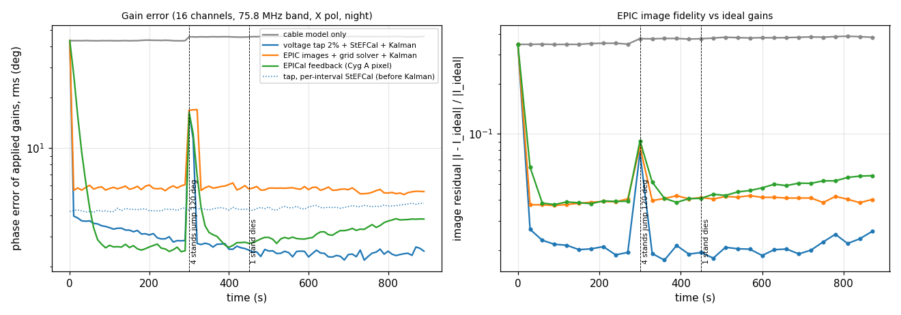
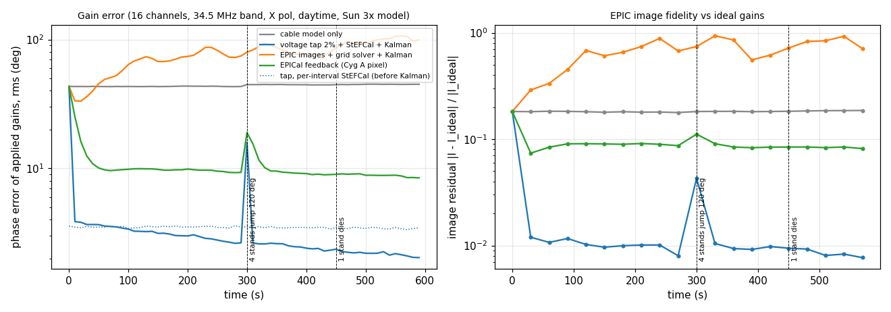
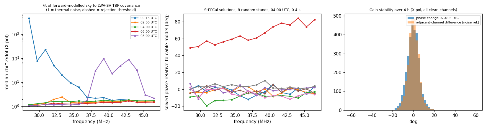

# 3. Experiments

## Common setup

All simulations use:

- **Geometry:** the production imaging geometry.
  - 229 used stands (the `epic_geometry.used_stands()` mask).
  - Stand-plane phase centre.
  - 128×128 grid at 1.056°.
  - 5×5 w-projected prolate kernels.
  - NDP channel width of 23.93 kHz.
- **Truth sky:**
  - LFSM at nside 128, multiplied by small-scale structure with 10% rms on 1–6° scales (absent from the model).
  - 25 sources of 100–800 Jy absent from the model.
  - Cyg A, Cas A and Tau A fluxes in error by +8%, −7% and +10%.
  - Cyg A and Cas A shifted by about 0.1° (ionospheric refraction).
  - Receiver noise of 15% of the sky power.
- **Model sky:** LFSM at nside 64 with nominal A-team fluxes.
- **Noise:** sample covariances are drawn from the complex Wishart distribution (Bartlett decomposition) for the stated number of samples.

Scripts are in `src/python/streamcal/research/`.

## 3.1 Representation of the diffuse sky

The model is built from HEALPix pixels treated as point sources. With StEFCal on exact covariances at 75.8 MHz, a coarse model alone produced:

| Model | Phase bias | Amplitude bias |
|---|---|---|
| nside 16 against nside 32 truth | 10.6–11.6° | 48–65% |
| nside 64 against nside 128 truth | 0.19–0.28° | 0.8–1.1% |
| nside 64 against nside 128 truth, 34.5 MHz | 0.14–0.26° | |

The coarse model fails because its pixels (1.8–3.7°) are coarser than the fringe spacing of the longest baselines (about 2° at 75 MHz), so the point-pixel representation aliases. nside 64 (0.9°) is the minimum.

## 3.2 Sensitivity to sky-model error: covariance against images

Same data and same model, 75.8 MHz, noise-free, initial errors of 40° in phase and 20% in amplitude. Each cell shows the bias as amplitude-and-phase rms / phase rms.

| Model error alone | StEFCal on covariance, ≥1λ | Grid solver on images, ≥1λ | StEFCal, ≥3λ | Grid solver, ≥3λ |
|---|---|---|---|---|
| Small-scale diffuse structure (10%) | 0.010 / 0.41° | 0.063 / 2.23° | 0.012 / 0.45° | 0.067 / 2.31° |
| Pixelisation, nside 64 against 128 | 0.002 / 0.01° | 0.004 / 0.15° | 0.003 / 0.01° | 0.004 / 0.09° |
| Missing faint sources and A-team flux errors | 0.006 / 0.20° | 0.041 / 1.74° | 0.007 / 0.26° | 0.042 / 1.79° |
| Diffuse sky absent from the model | 0.241 / 1.44° | 0.493 / 11.6° | 0.209 / 0.97° | 0.348 / 6.53° |

Two further observations:

- **Images are 5–10× more sensitive.** The image-domain solution is 5–10 times more sensitive to the same model error. Inverse-noise cell weighting already reduced its error from 7.5° to 4.6° (uniform weighting is worse).
- **Short baselines help the covariance solver.** Keeping baselines down to 1λ helps StEFCal, because at these frequencies the diffuse sky carries much of the signal and the model represents it adequately.

At 34.5 MHz the image route degrades further. The array spans only about 30 of the 128 uv cells, so each cell sums more baselines.

| 34.5 MHz, noise-free | Grid solver on images | StEFCal on covariance |
|---|---|---|
| Night (06:00 UTC) | 17° (2 outer iterations), 11.5° (10) | 0.25° |
| Day (19:00 UTC), Sun 3× model, Sun fixed | 40–53° | |
| Day, Sun solved | 26–31° | 0.41° |

## 3.3 Gain information per unit of data

Perfect model, 75.8 MHz, single channel, mean over 3 trials (phase rms):

| Integration | Images, 100% of samples | Tap 10% | Tap 3% | Tap 1% | Covariance, 100% |
|---|---|---|---|---|---|
| 1 s | 5.2° | 5.9° | 11.5° | 23.0° | 1.9° |
| 5 s | 2.5° | 2.9° | 5.1° | 8.6° | 0.84° |
| 20 s | 1.2° | 1.3° | 2.4° | 4.3° | 0.43° |

The images carry the gain information of about a 10% tap. Gridding loses roughly a factor of 3 in phase error against the full covariance from the same samples.

## 3.4 Closed-loop streaming calibration

`research/sim_loop.py` runs four methods side by side on 16 channels (X polarisation) over 10 s intervals. In each interval the instrument produces the full-rate covariance (what the GPU images) and a 2% tap. Each method's tracker output is the gain table applied in the next interval.

The true gains include:

- amplitudes with 20% scatter and 5% ripple;
- phase offsets up to ±72°, delays of 3 ns rms and 5° phase ripple;
- a random walk of 3°/min in phase and 0.05 ns/min in delay;
- 120° jumps on 4 stands at 300 s;
- one stand losing 98% of its gain at 450 s.

**75.8 MHz, 2026-10-16 06:00 UTC (night), 900 s.** Medians over t ≥ 60 s:

| Method | Phase error | Amplitude + phase | Image residual | Recovery after jumps | Dead stand |
|---|---|---|---|---|---|
| Cable model only | 45.6° | 0.76 | 0.377 | | |
| **2% tap + StEFCal + Kalman** | **2.52°** | **0.051** | **0.020** | 20–30 s | flagged |
| Images + grid solver + Kalman | 5.79° | 0.125 | 0.041 | about 30 s | flagged |
| EPICal (Cyg A pixel, full rate) | 2.95° | 0.269 | 0.044 | about 60 s | not flagged |

**34.5 MHz, 2026-10-16 19:00 UTC (day), Sun at 3× the quiet-Sun model, 600 s.** The tap and image solvers solve the Sun flux.

| Method | Phase error | Amplitude + phase | Image residual | Notes |
|---|---|---|---|---|
| Cable model only | 44.5° | 0.77 | 0.182 | |
| **2% tap + StEFCal + Kalman** | **2.6° (2.0° at the end)** | **0.050** | **0.010** | Sun scale 2.97–3.04 (true 3) |
| Images + grid solver + Kalman | 79° (diverges) | 10.6 | 0.715 | 30 stands wrongly flagged |
| EPICal (Cyg A pixel) | 9.4° | 0.50 | 0.086 | Biased: Sun absent from its model |

The comparison favours EPICal in two respects:

- It is given the exact full-rate antenna-pixel correlation, which epic++ cannot produce (section 1.3).
- At night Cyg A dominates, so its two-source model is nearly adequate.

It converges in about 60 s and is then limited by model bias, mainly in amplitude. The Kalman filter halves the per-interval StEFCal error: 4.5° to 2.4° at 75.8 MHz, and 3.5° to 2.0° at 34.5 MHz.

## 3.5 End-to-end test of the service

`tests/streamcal/test_daemon.py` writes visibility tables in the exact CalTap layout. Their content is:

- raw convention (cable delays included);
- a 5% tap over 10 s;
- an nside 128 truth sky with 25 extra sources;
- true residual gains with 15% amplitude scatter, ±60° phase and 3 ns delays;
- two stands at 1% gain.

The test runs `streamcal.daemon` (8 of 128 channels solved, Sun free), reads the gain table it publishes, and checks that the correction multiplied by the true gain is constant across stands:

| Interval | Phase error X / Y | Amplitude error X / Y | Dead stands |
|---|---|---|---|
| 1 | 1.31° / 1.35° | 4.6% / 4.8% | flagged |
| 6 | 1.10° / 1.15° | 2.2% / 2.4% | flagged |

The test passes. A first run caught dead stands that were excluded by the power check but left unflagged (correction 1 instead of 0). The daemon flags stands with abnormal power in most channels.

Daemon cost, measured on one Xeon Silver 4210 node with 8 BLAS threads:

- **Solve:** 0.4 s per table for 32 channels × 2 polarisations.
- **Model refresh:** 12 s for the same channels, every 60 s, after moving the steering phases to float32 (relative error 2.5×10⁻⁷) and evaluating the beam once per frequency (previously about 70 s).

## 3.6 LWA-SV data (EPIC Memo 12 TBF captures)

**Data.** TBF captures of 2023-09-17 (ADP F-engine, 25 kHz channels, 28.2–48 MHz, the EPIC Memo 12 data set). From each capture, 10,000 samples (0.4 s) were correlated at 16 channels.

**Processing.**

- The covariance was corrected with the LSL cable model.
- Inputs with power outside 0.3–3× the median were dropped.
- StEFCal was solved against the forward model (nside 64) per channel and polarisation.

**Sign convention.** For the 00:15 UTC capture, the relative residual ‖R − GMGᴴ‖/‖R‖ is 0.739 with the convention of section 1.1 and 0.924 with the conjugate. The convention is confirmed.

**Fit quality.** Median χ²/dof per channel (X polarisation; 1 = thermal noise):

| UTC (LST) | Clean channels: χ²/dof | Channels rejected (χ²/dof > 3) |
|---|---|---|
| 00:15 (16.8 h) | 1.7–2.4 (37–47 MHz) | 28.5–35.7 MHz: 6.3 to 4,657 |
| 02:00 (18.6 h) | 1.1–2.4 (all 16) | none |
| 04:00 (20.6 h) | 1.2–1.9 (all 16) | none |
| 06:00 (22.6 h) | 1.1–1.7 (all 16) | none |
| 08:00 (0.6 h) | 1.1–1.8 (28.5–36.9 MHz), 2.2 (46.5 MHz) | 38.1–44.1 MHz: 23 to 99; 45.3 MHz: 3.0 |

**Findings.**

- **Model adequacy.** In clean channels the forward model and StEFCal fit the LWA-SV covariance to χ²/dof 1.1–1.9. Before calibration, the correlation between data and model (cable model only) is 0.5–0.76.
- **RFI is time- and frequency-dependent.** It occupies 28–36 MHz in the early evening and 38–44 MHz after local midnight. The χ² gate of the daemon (> 3) rejects these channels. Without the gate, a single 0.4 s capture produced residual delays of 33–37 ns rms and 62–66° phase scatter, which is pure noise.
- **Error left by the cable model.** Robust statistics of the solved gains against the LSL cable model, in clean channels:
  - phase 6.4–8.0° (MAD);
  - delay 1.1–1.2 ns (MAD);
  - amplitude 10–12% (MAD, after removing the bandpass common to all stands);
  - a heavy tail (plain rms 25–29°), including at least one stand 50–85° off with a 2 ns slope;
  - 0.5–2% of inputs with near-zero gain that the SSMIF does not flag.
- **Sensitivity cost.** The point-source coherence of the cable-only weights, $`|\sum\varepsilon|^2/(N\sum|\varepsilon|^2)`$, is 0.83–0.87. Calibration therefore recovers 13–17% of point-source S/N in EPIC images, and more dynamic range through the outliers.
- **Stability.** Between 02:00 and 06:00 UTC, the core of the per-channel phase-change distribution matches the noise of two 0.4 s solutions (about 5° per channel). The rms, which includes the tails, is 12–16°, with structured parts of 5–7° (offset) and 1.3–3 ns (delay) and about 10% in amplitude. Instrumental gains drift on hour time scales, so 10–60 s solution intervals with tracking are ample.

## 3.7 CPU X-engine throughput

`src/ex/xengine.hpp` on epic1 (Threadripper PRO 5965WX, g++ 11.4, `-O3 -march=znver3 -fopenmp`), 128 channels, XX and YY, 256 stands, 1000 sequences per call. The result is bit-exact against a scalar reference.

| Threads | Time per 1000-sequence gulp | Throughput | Share of full rate |
|---|---|---|---|
| 1 | 641 ms | 13.1 GCMAC/s | 6.5% |
| 4 | 164 ms | 51.4 GCMAC/s | 25% |
| 8 | 83 ms | 101.8 GCMAC/s | 51% |

The tap's default of 50 sequences per gulp needs 0.77 of a core in steady state.
