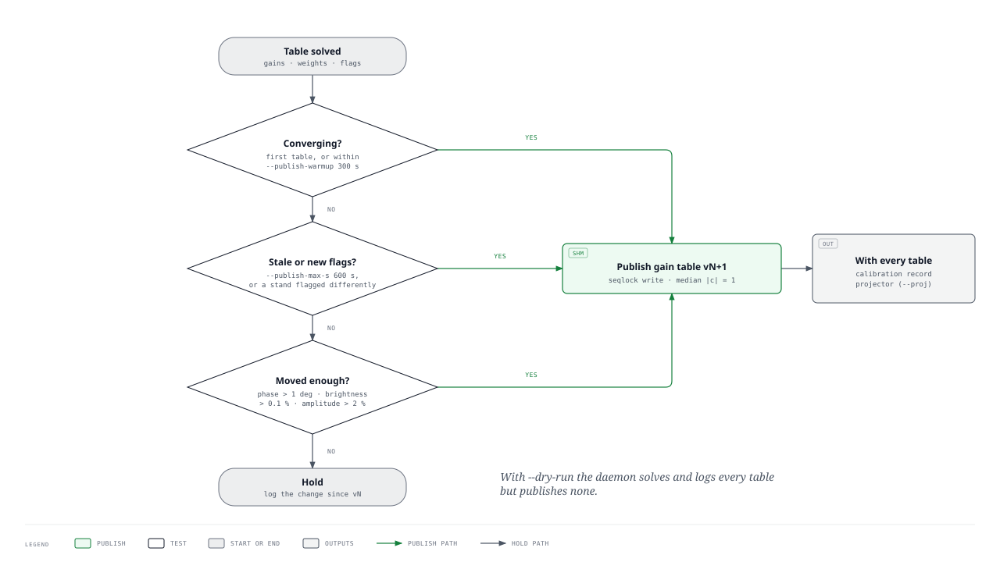

# 4. Implementation: CPU solution, GPU application

The code was developed on branch `streaming-calibration` (from `phoenix` at v0.19.0, 670d6da) and merged into `phoenix-fx`; this section describes it as it stands in `phoenix-fx` at commit `b67ed6b`. Every feature is off by default: an epic++ started without the calibration options images with the nominal phases, and a daemon started without `--calinfo` or `--proj` publishes only the gain table.

## 4.1 Data flow

*Figure 4.1. The calibration loop on one imaging node. PNG: [figures/streamcal-loop.png](figures/streamcal-loop.png); source: [figures/src/streamcal-loop.html](figures/src/streamcal-loop.html).*

1. **Tap.** The NDP receiver assembles gulps time-major, `[seq 1000][chan][board][32 inputs]` (4+4 bit), and the imaging GPU transposes each stream's channels to `[chan][seq][stand 256][pol 2]` and zeroes the samples of lost packets (`src/MOFF_cu_handler.cu`). With `--caltap_gpu` the tensor-core correlator of `TccTap` (`src/ex/tcc_tap.cu`) correlates that device copy on its own CUDA stream, before any projection, gain or impulse flag, and publishes every `--caltap_interval` seconds (10) the visibility table `/dev/shm/epic_vis_gpu<N>` (seqlock, 134 MB for 128 channels, 201 MB for 192). The CPU tap (`--caltap_nseq`, `CalTap` with the AVX2 X-engine) reads channel-major host gulps only; the correlator disables it for time-major gulps with a warning, so with NDP data the GPU tap is the only route.
2. **Solution.** The streamcal daemon reads each table, evaluates the sky model at the table's mid time (interpolated between snapshots `--model-refresh` apart), solves gains, fluxes and positions per channel and polarisation, and updates the per-stand trackers (section 4.4).
3. **Publication.** The daemon forms the relative corrections and decides by the publication policy (section 4.4.2) whether to publish them to `/dev/shm/epic_gains_gpu<N>` (seqlock, 512 KiB for 128 channels). With every published table it writes the calibration record (`--calinfo`, section 4.4.3) and, with `--proj`, the interference projector.
4. **Application.** At the first gulp of every image `CorrelatorRft` polls the gain table (`GainTableReader::Poll`) and, if a newer valid table is found, multiplies it into the nominal phases and uploads them (`ApplyGainTable`). The image metadata record the `gain_version`, which reaches the all-sky monitor in every slot of the sky ring.

## 4.2 epic++ changes

| File | Change |
|---|---|
| `src/ex/gain_table.hpp` (new) | `GainTableHeader` (128 bytes) and `GainTableReader`, which reads under a seqlock. A table is rejected if the magic or layout is wrong, if the version is not newer, if `valid_from_seq` lies in the future, if it does not cover the imaged channels, or if it contains non-finite values or values above `max_abs` (64). Also `ApplyGainCorrections`, which multiplies nominal × table. |
| `src/ex/xengine.hpp` (new) | CPU X-engine: 4+4-bit unpack to int16 pairs, `vpmaddwd` in 2×3 register tiles, OpenMP over channels. Output is int64 accumulators for the XX and YY upper triangles. |
| `src/ex/cal_tap.hpp` (new) | `CalTap` has a one-slot mailbox, a stager thread and an X-engine thread. The stager copies `nseq` sequences per channel from the offered gulp into one of two staging batches while `ProcessGulp` runs; the correlator calls `WaitCopied()` before releasing the gulp. A full batch (`--caltap_batch` gulps, default 8) goes to the X-engine thread. Correlating one gulp per call kept up with only every second gulp, because the read-modify-write of the 134 MB accumulator dominates at 50 samples; batching keeps up with every gulp (section 7). The X-engine thread publishes `VisTableHeader` plus R as complex64 (Hermitian, R = Σxxᴴ / nsamp) under a seqlock. No `Payload` is shared across threads, because `Payload` unlocks its buffer on `use_count() == 2`, which is not thread safe. |
| `src/ex/tcc_tap.{h,cu}`, `src/ex/vis_table.hpp` | `TccTap`, the GPU calibration tap (`--caltap_gpu`; needs `-DEPIC_TCC_ROOT`). For every gulp that passes `Arm` (right shape, `data_quality` ≥ `--caltap_min_quality`, 0.98) it waits for the imaging streams' copies, reorders the 4-bit device gulp to the int8 layout of the Tensor-Core Correlator (`[chan][seq/16][input][16][re, im]`, zero-padded to a multiple of 16 sequences) and correlates it into one of two int32 accumulators; each imaging stream waits only for the reorder before overwriting the device gulp. After `--caltap_interval` seconds of F-engine time (at most 600 s, the int32 limit) the accumulator is copied to the host on a second stream while the next integration starts in the other one, and a publisher thread (kept off the receiver's CPU) writes the XX and YY blocks as the Hermitian R under the seqlock (`note` `tcc-i8 v1`). If the publisher is still busy the integration continues. A change of `chan0` drops the partial integration. `--caltap_record_dir` also writes every table to `vis_<version>.bin`. **Sample weights:** see below. |
| `src/ex/MOFF_cu_handler.{h,cu}` | `UpdatePhases`: an in-place synchronous `cudaMemcpy` into the existing `m_phases_cu`, with no reallocation. It is safe between gulps because `ProcessGulp` returns only after all streams finish. |
| `src/ex/MOFF_correlator.hpp` | Keeps `m_phases_nominal` (from `GetLwasvPhases`). `ApplyGainTable` sets `m_phases = nominal ⊙ table` and uploads it. A new spectral window resets the gain version to 0, i.e. nominal phases. Adds `GetGainVersion` and `GetCalDesc`. |
| `src/raft_kernels/correlator.hpp` | Polls the gain table at the first gulp of every image, so each image is made with exactly one table; a change of spectral window resets the gain reader. Arms the GPU tap for every gulp and passes it the gulp's validity mask; offers channel-major gulps to the CPU tap and, for time-major gulps (`data_order` `t_maj`, the NDP receiver), disables the CPU tap with a warning. Adds `gain_version` (uint64) to the image metadata. With `--proj_table`, polls the projector at the same point and adds `proj_version`, `proj_q` (uint64) and `impulse_flag_frac` (double) to the image metadata; without the interference options the metadata are unchanged. |
| `src/ex/fx_imager.cu` | In the FX imager the gains folded into the phases are applied to each visibility as $`g_{p,a}\,g_{q,b}^*`$ inside the lag gridder and the peeling fit; a stand with zero gains (flagged) is skipped. |
| `src/ex/types.hpp`, `option_parser.hpp`, `kernel_types.hpp` | New options (below). `{gpu}` in paths is replaced by the device id. |
| `CMakeLists.txt` | Links `OpenMP::OpenMP_CXX` into epic++, for the X-engine. |
| `src/ex/buffer.hpp` (fix) | `Payload::unlock` released the buffer (`m_lock = 0`) before `ResetBuf()` cleared its metadata. A producer acquiring the buffer in that window wrote metadata concurrently with the reset and crashed in `unordered_map::operator[]`. It reproduced reliably with the benchmark generator under backpressure; the production packet assembler is exposed to the same race. Fixed by resetting first, then releasing with release ordering. |
| `src/ex/proj_table.hpp` (new) | `ProjTableHeader` (128 bytes) and `ProjTableReader` for the interference projector (section 10.8). Same seqlock and validity rules as the gain table; in addition a table is rejected unless, in each polarisation, $`\tilde V^H \tilde U`$ is the identity on the components in use to 5%. |
| `src/ex/rfi_stage.{h,cu}` (new) | `RfiStage`, on the imaging GPU after each stream's host-to-device copy. `RfiProject` (one block per channel and sequence, one thread per stand) replaces $`x`$ by $`x - \tilde U(\tilde V^H x)`$ per polarisation, re-quantises to 4+4 bits with a uniform counter-based dither (symmetric clip ±7), writes a second gulp buffer and records the power of every channel and sequence. `ImpulseFlag` (one block per stream) zeroes the sequences whose sub-band power exceeds the gulp median by `--impulse_sigma` robust standard deviations (bitonic sort for median and MAD). With a Sun vector in the table, the power tested is the band power minus the Sun-beam power, so solar bursts are kept (section 10.8). The raw buffer is untouched, so the calibration tap keeps correlating unprojected voltages. |
| `src/raft_kernels/bench_kernels.hpp` (new), `epic_executor.hpp` | `epic++ --bench`: `BenchGulpGen` → `CorrelatorRft` (with tap and gain table) → `ChanReducer` (with `--sky_shm`, the sky ring) → `BenchSink`. Only these kernels are constructed, so nothing connects to the database, video server or network. The generator plays simulated gulps from a file, rotating each channel's sequences on every pass so the tap sees new samples, or sends empty gulps; it runs unpaced or at the real-time rate. The sink reports image cadence and gain version and dumps sampled images. |

Options:

| Option | Default | Meaning |
|---|---|---|
| `--gain_table PATH` | empty (off) | Gain table to apply, e.g. `/dev/shm/epic_gains_gpu{gpu}` |
| `--proj_table PATH` | empty (off) | Interference projector to apply before imaging, e.g. `/dev/shm/epic_proj_gpu{gpu}` (daemon `--proj`) |
| `--impulse_sigma S` | 0 (off) | Zero sequences whose stream sub-band power exceeds the gulp median by S robust standard deviations |
| `--caltap_gpu` | off | GPU tap: correlate every sample of every gulp with the tensor-core correlator (needs `-DEPIC_TCC_ROOT`); excludes `--caltap_nseq` |
| `--caltap_min_quality Q` | 0.98 | GPU tap: skip gulps with less valid data than this fraction |
| `--caltap_record_dir DIR` | empty (off) | GPU tap: also write every published table to `DIR/vis_<version>.bin` |
| `--vistap` | off | Run only the receiver and the GPU tap for `--runtime` seconds (calibration data takes); see the limitation in section 4.7 |
| `--caltap_nseq N` | 0 (off) | CPU tap (channel-major gulps only): sequences of every 1000-sequence gulp that are correlated (50 = 5%) |
| `--caltap_out PATH` | `/dev/shm/epic_vis_gpu{gpu}` | Visibility table output |
| `--caltap_interval S` | 10 | Integration per published table, in seconds of F-engine time |
| `--caltap_threads N` | 2 | X-engine threads (not pinned; the raft kernels use CPUs 3–11 for GPU 0) |
| `--caltap_batch N` | 8 | Gulps staged per X-engine call |
| `--bench`, `--bench_data`, `--bench_seq0`, `--bench_ngulps`, `--bench_realtime`, `--bench_rotate`, `--bench_dump`, `--bench_dump_every`, `--bench_report` | off | Benchmark mode (section 7) |

**Sample weights in the GPU tap.** The receiver zeroes the samples of lost packets on the GPU, so an integration with lost packets would give a table low by the lost fraction of each pair. The validity mask of each gulp (one bit per board, channel block and sequence) is therefore passed to the tap (`SetGulpValidity`). From the first gulp of an integration that lost a packet on, the tap forms an int8 weight stream (1 for a valid sample, 0 otherwise, with the imaginary part zero) per input and correlates it with the same correlator into a second accumulator; the real part of a weight product counts the sequences in which both samples were valid. The complete gulps of the integration before the first lossy one are counted on the host (`weighted_base`). Each product of the table is then divided by its own number of valid samples, `weighted_base + w_ab`, instead of by `nsamp`; an integration without losses keeps the division by `nsamp`. With 10% of the packets lost the table equals the lossless one to a ratio of 1.0001 (5–95%: 0.994–1.006; commit a006713). The FX imager normalises its visibilities in the same way (`docs/pipeline/DESIGN.md`, section 5.3).

## 4.3 Shared-memory layouts

Both tables are little-endian files in `/dev/shm` with a 128-byte header. The `seq` field is odd while the writer is updating the table. A reader copies the header and data, then re-reads `seq` and discards the copy if it changed. The Python twins are in `src/python/streamcal/shm.py`.

**Gain table** (`EPICGAIN`, layout 1). The corrections must be relative: the reader rejects a table whose median non-zero |c| lies outside 0.25–4, and the Python writer refuses to write one. The solved gains carry an absolute scale (F-engine counts per Jy^½, about 0.01). Publishing 1/g directly would scale the voltages by about 100 and overflow the half-precision gridding and FFT. In the integration test a table clipped at |c| = 32 turned every image into NaN (section 7.3). The daemon normalises each channel and polarisation to median |c| = 1 and keeps the absolute scale for the flux-scale monitor.

| Offset | Field |
|---|---|
| 0 | `magic[8]` |
| 8 | `layout`, `header_bytes` (u32 each) |
| 16 | `seq` (u64) |
| 24 | `version` (u64) |
| 32 | `chan0` (i64) |
| 40 | `nchan`, `nstand`, `npol`, `flags` (u32 each; flags bit 0 = valid, 0 = revert to nominal) |
| 56 | `valid_from_seq` (u64) |
| 64 | `t_solved_unix` (f64) |
| 72 | `max_abs` (f32), reserved (u32) |
| 80 | `solver[48]` |
| 128 | data: complex64 `[nchan][256][2]` |

**Visibility table** (`EPICVIS1`, layout 1):

| Offset | Field |
|---|---|
| 0 | `magic[8]` |
| 8 | `layout`, `header_bytes` (u32 each) |
| 16 | `seq` (u64) |
| 24 | `version` (u64) |
| 32 | `chan0` (i64) |
| 40 | `nchan`, `nstand`, `npol`, `flags` (u32 each) |
| 56 | `nsamp` (u64) |
| 64 | `seq_first` (u64) |
| 72 | `seq_last` (u64) |
| 80 | `ngulps`, `nskipped` (u32 each) |
| 88 | `gulp_nseq` (u64) |
| 96 | `duty` (f32) |
| 100 | `note[28]` |
| 128 | data: complex64 `[nchan][2][256][256]` |

The visibility table holds raw F-engine correlations, before cable model and phases. It occupies 134 MB for 128 channels and 201 MB for 192.

**Interference projector** (`EPICPROJ`, layout 1). Written by `ProjTableWriter` (daemon `--proj`) after every gain table. Each component acts on the inputs of one polarisation (input index 2 × stand + pol); components beyond `q` are zero. 4 MB for 128 channels and `qmax` = 4.

| Offset | Field |
|---|---|
| 0 | `magic[8]` |
| 8 | `layout`, `header_bytes` (u32 each) |
| 16 | `seq` (u64) |
| 24 | `version` (u64) |
| 32 | `chan0` (i64) |
| 40 | `nchan`, `ninput` (512), `qmax`, `q`, `flags` (bit 0 = valid, bit 1 = Sun vector present), reserved (u32 each) |
| 64 | `valid_from_seq` (u64) |
| 72 | `t_solved_unix` (f64) |
| 80 | `solver[48]` |
| 128 | data: complex64 $`\tilde U`$ `[nchan][qmax][512]`, then $`\tilde V`$ `[nchan][qmax][512]`, then the Sun vector `[nchan][512]` (projected, unit norm per polarisation; space always allocated, valid when flags bit 1 is set) |

**Calibration record** (JSON, layout 1). Written by `calinfo.write` beside the gain table with every published table when the daemon runs with `--calinfo PATH` (for example `/dev/shm/epic_calinfo_gpu0.json`). The record is written to a temporary name and renamed, so a reader never sees a partial file. It carries what the all-sky monitor cannot measure itself (requirements C1–C7 of [docs/skymon/streamcal-interface.md](../skymon/streamcal-interface.md)); its content is described in section 4.4.3.

## 4.4 streamcal (Python)

| Module | Content |
|---|---|
| `geometry.py` | Wraps `epic_geometry` (stands, plane frame, used-stand mask), `CHAN_BW` |
| `sky.py` | A-team spectra: de Gasperin et al. 2020 for Cas A, Cyg A and Vir A by default (`STREAMCAL_ATEAM`); Baars et al. 1977 shapes below 30 MHz; Tau A low-frequency fit. Also the quiet Sun and the diffuse sky: `diffuse(model="auto")` uses the OVRO-LWA hybrid at 30–80 MHz and LFSM otherwise, with the A-team inpainted. Optional VLSSr sources as fixed flux (`STREAMCAL_CATALOG`), small-scale fluctuations for simulation, and the tables in `data/` |
| `forward.py` | Sky snapshot (directions and beam-weighted fluxes per component; `diffuse_model`, optional `beam_corr`) and model matrices $`M = A\,\mathrm{diag}(BS)\,A^H`$ as complex64 GEMMs |
| `beamcorr.py` | Beam-correction basis and `Table` (section 9.7) |
| `solvers.py` | `stefcal` (with free fluxes), `stefcal_sky` (source fluxes and positions, guard rails, the refraction prior `prior_off_deg`/`prior_neff`/`prior_nsamp`), `anchor_offsets`, `sky_fraction`, `gridcal` (grid-domain Gauss-Newton/CG), `Tracker` (Kalman filter on phase and delay, amplitude and bandpass smoothing, jump detection) |
| `epicop.py` | Exact epic++ image operator (scatter and gather, numba) for the grid-domain solver and the image monitor |
| `rfi.py` | Interference subspace detection on the whitened residual (`detect`, `lowrank_offdiag`, noise edges), the oblique projector $`P = D^{1/2}(I - UU^H)D^{-1/2}`$ (`Projector`), the model fill `model_cov`, and the sky-focus test `sky_focus` (section 10.8) |
| `shm.py` | `GainTableWriter`, `ProjTableWriter`, `VisTableReader` |
| `calinfo.py` | The calibration record for the all-sky monitor: `record` (fields C1, C2, C3 and C5 of the interface) and `write` (atomic replacement); section 4.4.3 |
| `daemon.py` | `python -m streamcal.daemon --vis … --gains … [--dry-run]`. Two passes per table. The first solves gains, fluxes and positions per channel; on a cold start, gains are solved first against the nominal sky. The source offsets are then fitted to $`(f_c/f)^2`$ across the band. The second pass re-solves gains and fluxes with positions fixed. Channel jobs run in a process pool (`--workers`, default 8). The Kalman time step comes from the data timestamps. The sky model is interpolated between snapshots (`--model-interp`), the weights, amplitudes and flags are smoothed, and the tables are published by a policy (sections 4.4.1 and 4.4.2), with the calibration record (`--calinfo`, section 4.4.3). Section 10 adds:
  - the anchored source frame (`--free-frame` to disable);
  - the refraction prior (`--refraction-prior-deg`, `--refraction-prior-neff`, `--refraction-tau`);
  - matched-filter weights (`--plain-weights` to disable);
  - the diffuse map choice (`--diffuse-model`, default `auto`);
  - the interference projection (`--rfi auto|off`, `--rfi-kmax`, `--rfi-mm`, `--rfi-refresh`, `--rfi-thresh`, `--rfi-focus`; section 10.8), and with `--proj PATH` its voltage-domain projector for the imager. |
| `research/` | Every simulation and real-data script behind sections 3, 6, 7 and 10 (including `replay_tables.py`, which replays recorded GPU-tap tables through the daemon, and `vistable_to_npz.py`), including the benchmark tools (`make_bench_model.py`, `make_bench_gulps.py`, `bench_run.sh`, `bench_watch.py`, `bench_images.py`) |

### 4.4.1 Stability of the published calibration

Every published table changes the images. The all-sky monitor resolves a change of about 0.1% in a pixel's brightness, and its running baselines would take a step of the calibration for a broadband pulse. A replay of 113 GPU-tap tables recorded at 75.8 MHz through the daemon showed the published tables moving the images by 0.06–0.07% every 10 s, with a phase jolt of 4° every minute (commit e504938). The daemon was changed in four ways, each with its own option.

**Interpolated sky model** (`--model-interp on`, the default; `StreamCal.model_at`). A model held for `--model-refresh` seconds (60) falls behind the sky, which turns 0.25° per minute; the gains absorbed the growing model error and jumped back at every refresh, a sawtooth of 4° in phase and 0.5% in the brightness of sources each minute. The daemon keeps two snapshots, A at t_a and B at t_a + `--model-refresh`, and evaluates the model at each table's mid time t by linear interpolation with w = (t − t_a)/(t_b − t_a), clipped to 0–1.5:

- the diffuse model matrix of each channel and polarisation, $`M_d = (1-w)M_{d,A} + w M_{d,B}`$;
- the direction of every compact source, interpolated and renormalised to a unit vector, and its apparent (beam-weighted) flux, interpolated linearly;
- a source that rises or sets between the snapshots (a different source list) takes the list of the nearer snapshot.

When t passes t_b, B becomes A and a snapshot one refresh later is built; a table more than one refresh before t_a or more than three refreshes after it restarts both snapshots. With `--fixed-time` (tests on static data) or `--model-interp off` the model is held and rebuilt every `--model-refresh` seconds, as before. In the daemon's end-to-end test with a sky that turns between tables, the phase errors fell from 3.6–3.9° with the held model to 1.3°.

**Smoothed sky fractions** (`--weights-tau`, 600 s; `update_skyfrac`). The matched-filter weights $`c_a \propto (1/g_a)\min(1, 
ho_a/ar
ho)`$ (section 10.2) use each stand's sky fraction ρ_a = |g_a|² M_aa / R_aa. Estimated from each table alone it varied by about 0.3 between tables and moved the images more than the gains did (0.08% of the diffuse brightness per table, against 0.015% with fixed weights). The fraction of each stand and polarisation is the median over the solved channels of the accepted solutions, smoothed over tables as ρ ← (1 − k)ρ + kρ_new with k = min(1, Δt/τ), Δt the time between tables; a stand without a new estimate keeps its value.

**Amplitudes** (`--amp-tau`, 300 s; `Tracker.update`). The tracker averages the log-amplitude of each stand and solved channel with gain k = max(Δt/τ, 1/n), n the number of solutions averaged so far: the cumulative mean of all solutions until they span τ, an exponential average with time constant τ after that. The amplitudes thus converge quickly from a cold start and are smooth once converged. The per-channel phase bandpass keeps its exponential average with a time constant of 600 s (`tau_bp`), and phase and delay remain in the Kalman filter.

**Flag hysteresis** (`StreamCal.table`). A stand is flagged in a polarisation when its power is normal in fewer than half of the solved channels, when it was never solved, or when its mean gain amplitude is below `--flag-amp` (0.15) times the median. A flagged stand returns only once clearly back: power normal in at least 60% of the channels and amplitude at least 1.3 times the limit. A marginal stand therefore does not switch with every table, each switch being a change of the flags and so a table to publish.

### 4.4.2 Publication policy

*Figure 4.2. The decision taken after every solved table (`StreamCal.publish_reason`). PNG: [figures/streamcal-publish.png](figures/streamcal-publish.png); source: [figures/src/streamcal-publish.html](figures/src/streamcal-publish.html).*

After every table the daemon forms the corrections and compares them with the last published table (`publish_reason`). The table is published, with the reason logged, when:

| Reason | Condition | Option (default) |
|---|---|---|
| `first` | no table has been published | |
| `converging` | less than the warm-up has passed since the first table | `--publish-warmup` (300 s) |
| `age` | the last published table is at least this old | `--publish-max-s` (600 s) |
| `flags` | a stand is flagged (correction zero) in one table and not in the other | |
| `phase` | the rms over the stands of the phase change, after removing the common phase of each channel, exceeds this in either polarisation | `--publish-phase-deg` (1°) |
| `brightness` | the band-summed brightness of a compact source, $`\lvert\sum_a r_a
vert^2`$, or of the diffuse sky, $`\sum_a \lvert r_a
vert^2`$, changes by more than this, r being the ratio of the new to the published corrections | `--publish-bright-pct` (0.1%) |
| `amplitude` | the rms relative amplitude change, each channel's mean ratio removed, exceeds this | `--publish-amp-pct` (2%) |

The tests are applied in this order. Otherwise the table is held and the log line records the phase, amplitude and brightness changes since the published version. With `--dry-run` nothing is published. The solution history (`--save`) records every table with a flag that marks the published ones and, for those, the corrections. The Kalman trackers, the smoothed amplitudes and the sky fractions are updated with every table whether or not it is published, so a held table loses no information: the next published table carries everything solved so far.

### 4.4.3 The calibration record

The gain tables are relative, so the absolute scale the normalisation removed, and the calibrators that set it, are passed to the all-sky monitor in a separate record (`calinfo.record`), written with every published table:

| Field | Content | Interface |
|---|---|---|
| `layout` | 1 | |
| `gain_version`, `applied`, `t_solved_unix` | version of the published gain table, `true`, and the table's mid time | C1 |
| `chan0`, `nchan`, `solve_chans` | spectral window and the absolute channels that were solved | |
| `flux_scale` | `X`, `Y`: per channel the absolute scale F that the normalisation removed, `1 / median_a |c_a|` before normalisation (data counts per Jy^½), with `units` | C2 |
| `calibrators[]` | per compact source above 5° elevation (A-team and Sun): `name`, J2000 `ra_deg` and `dec_deg` (the Sun's at the table time), `alt_deg`, `az_deg`, `model_jy` (the intrinsic model spectrum at `solve_chans`), `free_flux` (true for the Sun), `scale` (the solved flux scale, the median over channels and polarisations) and `offset_deg` (the source offset of the refraction law at the band centre) | C3 |
| `quality` | `chi2_median`, `chi2_cut`, `rfi_channels` (solved channels rejected as interference) and `flagged_stands` (`X`, `Y`) | C5 |
| `model`, `solver` | names of the forward model and solver | |

No uncertainty (C4) and no beam table (C6, C7) are written; the monitor then uses its own dipole model. A failure to write the record is logged and leaves the gain table published; the monitor then leaves candidates without a flux. In the daemon's end-to-end test the absolute scale equals the true median gain amplitude to 0.8–1.0% (commit ad3ed57).

Dependencies beyond the epic310 environment: `pygdsm`, plus `numba` for `epicop` only. `lsl` provides the dipole beam and the cable model. The daemon imports neither numba nor the GPU stack.

## 4.5 Tests

| Test | Result (2026-10-16 unless dated) |
|---|---|
| `tests/streamcal/test_io.cpp selftest` (epic1, g++ 11.4) | 13/13 pass: the tap R (batched, two threads) matches a scalar reference; the gain reader handles a missing file, slicing, repeated versions, a torn seqlock, deferral by `valid_from_seq`, coverage, NaN, clamping and unnormalised tables; application and zero flags are correct |
| `tests/streamcal/test_shm_roundtrip.py` (epic1, epic310 Python) | Pass: Python writer → C++ reader, and C++ tap → Python reader |
| `tests/streamcal/test_rfi_stage.py` with `rfi/rfi_stage_driver` (epic2, RTX 4090; 2026-10-18) | Pass: `ProjTableWriter` → `ProjTableReader` → `RfiStage`. A table that is not a projector pair is rejected; without a projector the output equals the input bit for bit; with one, the interference power in the projected subspace falls to 3.5×10⁻⁴ of the input and the output differs from the floating-point projection by the dithered rounding only (mean 0.001, rms 0.408 per component against √(1/6) = 0.408); impulse detection at 6σ zeroes exactly the injected sequences in every stream; a short solar burst is zeroed without a Sun vector and kept with one |
| `tests/streamcal/test_daemon.py` | End to end on synthetic tap tables: see section 3.5 |
| `tests/streamcal/test_daemon.py` with the publication changes and the calibration record (2026-10-19; commits e504938, ad3ed57) | With a sky that turns between tables the phase error is 1.3° with the interpolated model, against 3.6–3.9° with a held one; the absolute scale of the calibration record equals the true median gain amplitude to 0.8–1.0% in both polarisations |
| GPU tap with 10% of the packets lost (2026-10-19; commit a006713) | The weighted table equals the lossless one to a ratio of 1.0001 (5–95%: 0.994–1.006) |
| `research/test_epicop.py` | epicop against literal MOFF: relative error 2.5×10⁻⁸; adjoint exact |
| Full epic++ build (epic1, CUDA 12.3, `build-streamcal/`) | Builds; no new warnings |
| `epic++ --bench` with simulated F-engine data, tap, daemon and gain table (section 7) | Real time kept (35.8 ms per 41.8 ms gulp); gains to 0.6° / 3–4% from ±70° / 20%; GPU image residual against exact gains 0.219 → 0.019 |

The X-engine benchmark is `research`-level code in `tests/streamcal/test_io.cpp` (tap mode); throughput was measured with the standalone bench (section 1.6).

## 4.6 Commissioning plan

Each step starts or reconfigures the imager and must be scheduled with the operators. The GPU tap has been run in `--vistap` mode for a data take at 75.8 MHz (section 10.8); these notes record no other step as completed.

1. **Tap only.**
   - Deploy the branch build on one node with `--caltap_gpu --caltap_interval 10` (full-rate tensor-core tap; the build needs `-DEPIC_TCC_ROOT`). The CPU tap (`--caltap_nseq`) cannot be used with the time-major NDP gulps.
   - Prefer a 57–76 MHz node (epic4–6): these bands matter most for FRBs and have no real-data validation in these notes (section 10.6), and their data quality is about 1.0. The GPU tap skips gulps below 98% valid data.
   - Check that `BlockEpicImager` exec_time and the gulp rate are unchanged (the tap runs on its own threads), and watch `nskipped`.
2. **Dry run.**
   - Run `streamcal.daemon --dry-run` beside it.
   - Check χ²/dof per channel (expected 1.1–2 in clean channels, section 3.6), the number of power-flagged inputs, the Sun scale, and the stability of the tracked delays over a day.
3. **Sign check on NDP data.** The convention was confirmed on ADP-era TBF data. The NDP F-engine must be checked the same way: the as-is and conjugated covariance must give clearly different χ² (section 3.6). This needs only the dry run.
4. **Apply.**
   - Add `--gain_table /dev/shm/epic_gains_gpu{gpu}` and drop `--dry-run`.
   - Compare A-team peak S/N and image rms before and after, and against the forward-modelled EPIC image of the model sky with the applied gains. This is the image monitor: `epicop.image_from_vis(op, W M W^H)` predicts the GPU image, and the ratio of A-team peaks gives a per-image flux scale in the manner of Kuiack et al. 2019.
5. **Six bands.** Repeat on all workers. The lowest bands (16.1 and 20.7 MHz) need the most attention to RFI gating and to ionospheric source shifts.

## 4.7 Open items

- **GPU-level test of gain application** in `tests/gpu/test_imager.cu`. A table with a linear phase ramp across the stands should shift a simulated source by the predicted number of pixels; a uniform |c| should scale the image by |c|². The Python operator reproduces the kernel exactly, but the CUDA path itself has not been run with a table.
- **Cross-hand (X–Y) phase.** It is left at the cable model by the gauge choice. Calibrating it needs the XY covariance, which the X-engine can produce at about one third extra cost, and a polarised model or the known zero-polarisation sky. The Stokes I images (XX+YY) do not depend on it.
- **Direction-dependent ionospheric shifts.** Add per-source position offsets as nuisance parameters for Cyg A and Cas A, as AARTFAAC does. The simulations include 0.1° shifts, which the direction-independent solution absorbs at the 1–2° level.
- **Sky model.**
  - **Done:** the A-team spectra of Cas A, Cyg A and Vir A come from de Gasperin et al. 2020. The integrated spectra are summed from their LOFAR LBA clean components (CDS J/A+A/635/A150, epoch 2015-08-26) into `streamcal/data/ateam_degasperin2020.csv`. Cas A fades at an assumed 0.7% per year. On the 14 night TBF captures, the fitted Cas A / Cyg A flux-scale ratio is 0.96 (IQR 0.82–1.19), against 1.70 with the Baars spectra. Both sources then need the same scale, about 0.8, at all elevations, which is the A-team relative to the diffuse map: a diffuse-map or beam calibration, not an A-team error. Tau A fits about 1.5× the de Gasperin value and keeps the earlier model. Below 30 MHz the spectra are extrapolated, and Cas A's low-frequency turnover is not modelled; check this before using them for the 16 and 21 MHz bands. Choice via `STREAMCAL_ATEAM`.
  - **Tested, no measurable gain:** 120–400 VLSSr sources above 20 Jy at 74 MHz (merged within 0.5°; `streamcal/data/vlssr_bright.csv`, `STREAMCAL_CATALOG=vlssr`), added as fixed flux. χ²/dof (1.59) and the residual fraction (0.1825) are unchanged, because the diffuse map and the beam dominate the residual. The option stays off by default.
  - Both tables are built by `research/build_sky_catalogs.py`; `research/sky_eval.py` scores a sky model on the TBF captures.
  - **Diffuse map default `auto`** (section 2.4). The OVRO-LWA hybrid is used at 30–80 MHz and LFSM outside that range (the 16 and 21 MHz bands) or when a node has no hybrid file.
    - The hybrid uses all eight release maps (36.5–73.2 MHz; `ovrolwa8_hybrid_n256.npz`, 28 MB), so it covers the 57, 72 and 76 MHz bands too.
    - It is installed on the local disk of every imaging node, in one of the locations listed in `sky.OVROLWA_MAPS`; `$STREAMCAL_OVROLWA_MAP` overrides them. A copy is kept in the shared archive. It is built by `research/prep_ovrolwa.py`.
    - On the TBF captures `auto` reproduces the OVRO-LWA result: χ²/dof 1.48, residual 0.1766.
  - **Catalogue and OVRO-LWA together.** The OVRO-LWA release removed only its eight brightest sources. With `STREAMCAL_CATALOG=vlssr`, the catalogue sources are inpainted out of the map (r 0.75°, annulus 0.75–1.25°), so they are not counted twice. The combination is neutral on the TBF captures (residual 0.1766–0.1767 for limits of 20 and 50 Jy).
  - **A-team below 30 MHz.** The de Gasperin data end at 30 MHz. Below that, the Baars spectral shapes are scaled to match at 30 MHz: Cas A 49 kJy at 20 MHz and 58 kJy at 16 MHz. These remain uncertain (the Baars Cas A fit is formally valid above 300 MHz). The daemon solves the A-team fluxes freely within 0.25–4× the catalogue, so the catalogue only sets the starting point for the 16 and 21 MHz bands.
  - Cache model matrices on an LST grid for every band.
- **Tracker tuning.** The process noise ($`2^\circ/\sqrt{\rm s}`$, $`0.05\ \mathrm{ns}/\sqrt{\rm s}`$) was chosen for simulated drifts. The measured drifts (section 3.6) are about 10× slower, so $`Q`$ can be lowered and the effective integration lengthened.
- **Gridding correction.** `gridding_correction` takes its live-stand mask from non-zero kernels, not from flags. Stands flagged by calibration remain in the correction's mean kernel, which is a small, smooth image-plane effect.
- **Power flagging under interference.** On the 75.8 MHz tables 38–49 inputs per polarisation are power-flagged, because the station-fixed interferer inflates the autocorrelations beyond the ±3× limits. The limits should be applied to the autocorrelations after the interference estimate is removed (section 10.8).
- **Prometheus metrics.** Export χ², flags, Sun scale, gain version, publication reasons and tap `nskipped` from the daemon. The image metadata carry `gain_version`, which the FITS writer copies with the other metadata as a long (HIERARCH) header card; an integration over several images records a single version even when the gains changed during it.
- **`--vistap` with NDP data.** `VisTapSink` (`src/raft_kernels/vistap_kernels.hpp`) copies the host gulp to the GPU as if it were channel-major. With the time-major gulps of the NDP receiver it neither transposes them nor zeroes lost packets nor passes the validity mask, so tables taken in this mode after the time-major receiver are not valid. The sink should use the correlator's upload path.
- **Cross-hand products in the tap.** The GPU tap publishes XX and YY only, although the correlator forms all four products.
- **Rebase cost in the all-sky monitor.** Every published table makes the all-sky monitor hold 24 images and rebase its baselines (docs/skymon/DESIGN.md, section 6.1). The publication policy keeps the number of tables low; its thresholds should be revisited against the monitor's false-alarm rate at gain changes.
