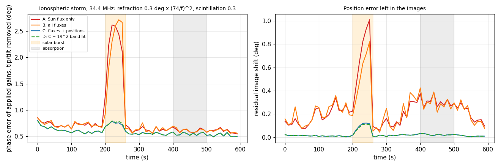
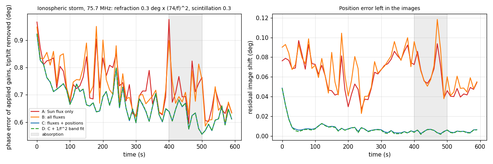

# 6. Ionosphere, solar activity and direction dependence

## 6.1 What changes, and what it does to a gain solution

StEFCal on its own assumes the model sky is correct and adjusts the gains until the data match it. Any change in the true sky that the model does not follow therefore leaks into the gains. At LWA-SV the relevant changes are listed below.

**Scintillation of compact sources.** At 20–80 MHz the A-team scintillates by tens of per cent on time scales of seconds. The irregularities that cause it have a Fresnel scale of $`\sqrt{\lambda h}`$, about 1 km. The array is about 100 m across, so a source brightens or fades coherently for every stand. It is a change of the source's apparent flux, not of the stand gains.

**Refraction.** Gradients in total electron content shift each source by an amount that depends on its direction, and that scales as $`f^{-2}`$. Medium-scale travelling ionospheric disturbances (periods of 10–60 min) and storms can produce tenths of a degree at 74 MHz, and about four to five times more at 34 MHz. A shift common to all sources is equivalent to a linear phase gradient across the gains, which is an image shift. Differential shifts cannot be absorbed by per-antenna gains at all.

**Absorption.** During solar flares, D-region absorption dims the whole sky, the diffuse emission included. This is indistinguishable from all gains dropping equally. It changes the flux scale but not the relative gains or the image quality.

**Solar radio bursts.** These are intrinsic to the Sun: its flux changes by one to three orders of magnitude within seconds to minutes. Burst sources also move through the corona.

Measured gain errors are below. The table uses exact covariances, noise-free, with a 40° and 20% initial gain scatter, solved by StEFCal against the nside 64 model with the bright sources fixed (`research/test_iono.py`). Phase is rms with the tip/tilt (image shift) removed; the shift is listed separately.

| Change in the true sky | 75.8 MHz, night | 34.5 MHz, day |
|---|---|---|
| Cyg A at 0.6× | 0.63°, 6.2% amplitude | 0.26°, 2.0% |
| Cyg A 1.5×, Cas A 0.7× | 0.96°, 4.4% | 0.30°, 2.5% |
| Refraction 0.3° × (74 MHz/f)² on Cyg A and Cas A | 0.10°, image shift 0.07° | 0.20°, image shift 0.16° |
| Solar burst, Sun 30× | | **90°: the solution is destroyed** |

## 6.2 Sky parameters solved with the gains

The bright compact sources are therefore live components of the model. In each interval, every bright source $`k`$ (Cyg A, Cas A, Tau A, Vir A, the Sun, whichever are above 5°) has three parameters:

- a real flux scale $`s_k`$;
- a tangent-plane offset $`\boldsymbol\delta_k`$.

They are solved together with the gains:

```math
M = M_{\rm diffuse} + \sum_k s_k\,S_k\,\mathbf a(\hat s_k+\boldsymbol\delta_k)\,\mathbf a^H(\hat s_k+\boldsymbol\delta_k),
\qquad a_a(\hat s) = e^{2\pi i f\,\mathbf r_a\cdot\hat s/c}.
```

For small offsets the model is linear in $`(s_k,\ s_k\delta_{k,1},\ s_k\delta_{k,2})`$:

```math
\frac{\partial M_{ab}}{\partial \delta_{k,j}} = \frac{2\pi i f}{c}\,(\mathbf r_a-\mathbf r_b)\cdot\mathbf t_{k,j}\;S_k\,a_a a_b^*,
```

where $`\mathbf t_{k,1},\mathbf t_{k,2}`$ span the tangent plane at $`\hat s_k`$.

`solvers.stefcal_sky` alternates two steps:

1. A linear least-squares update of the source parameters, with the current gains fixed. The directions are then moved by the solved offsets, clamped to 1° per step.
2. A few StEFCal iterations, with the sky fixed.

The order matters. In streaming the gains are known from the previous interval, but the sky may have changed. Updating the sky first prevents the gains from absorbing a burst before the Sun's flux has caught up. The first version ran StEFCal to convergence first and failed on the 30× burst (102°).

Across the band, the offsets of each source are fitted to $`\boldsymbol\delta(f) = \boldsymbol\delta_0\,(f_c/f)^2`$, weighted by the solved flux and pooled over both polarisations. The band is then re-solved with the positions fixed to the fit. The service logs the solved fluxes and offsets for every table, so it also serves as an ionospheric monitor.

The same snapshots, solved three ways:

| Change | Fixed bright sources | Free fluxes | Free fluxes and positions |
|---|---|---|---|
| Cyg A 0.6×, 75.8 MHz | 0.63° | 0.00° | 0.00° |
| Refraction 0.3° × (74/f)², 75.8 MHz | 0.10°, shift 0.07° | 0.10°, shift 0.07° | 0.01°, shift 0.01° |
| Refraction + Cyg A 0.6×, 34.5 MHz | 0.31°, shift 0.10° | 0.10°, shift 0.08° | 0.00° |
| Solar burst 30×, 34.5 MHz | 90° | 0.02° (Sun solved ×28.3) | 0.02° |

Absorption remains as a common scale. In the burst case the solution had a 3–5% amplitude offset, because with the Sun dominating, the absolute scale rests on the diffuse model. The flux scale is therefore monitored in the image domain (section 4.6), not taken from the gains.

## 6.3 Closed-loop storm simulation

`research/sim_storm.py` streams 10 s tap tables (5% of the samples, 16 channels, X polarisation) through four solver variants, each with its own Kalman tracker. True instrumental gains drift slowly (amplitude scatter 20%, phase ±70°, delay 3 ns rms, random walks of 1°/min and 0.02 ns/min).

The storm consists of:

- independent log-normal scintillation of every bright source, σ = 0.3 per interval;
- refraction of every bright source along a 10-minute disturbance, amplitude 0.3° × (74 MHz/f)²;
- a 30× solar burst at 200–260 s (daytime run);
- 30% whole-sky absorption at 400–500 s.



At 34.5 MHz in daytime (refraction 1.4° at the band centre), medians over t ≥ 60 s, applied gains:

| Variant | Phase (tip/tilt removed) | Worst | Image shift | Worst shift |
|---|---|---|---|---|
| A: model fixed except the Sun flux (first version of the service) | 0.64° | 2.62° (burst) | 0.24° | 1.01° |
| B: all bright fluxes free | 0.64° | 2.72° | 0.24° | 0.82° |
| **C: fluxes and positions free** | **0.56°** | **0.79°** | **0.016°** | **0.12°** |
| D: C plus 1/f² band fit | 0.56° | 0.79° | 0.015° | 0.11° |

At 75.8 MHz at night, with the same scintillation and absorption and no burst (refraction 0.29° at the band centre):

| Variant | Phase (tip/tilt removed) | Worst | Image shift | Worst shift |
|---|---|---|---|---|
| A | 0.71° | 0.98° | 0.060° | 0.094° |
| B | 0.70° | 0.95° | 0.065° | 0.118° |
| **C** | **0.65°** | **0.80°** | **0.006°** | **0.013°** |
| D | 0.65° | 0.80° | 0.006° | 0.013° |



- **Gain error:** solving positions keeps the error flat through the burst, and absorption changes nothing for any variant.
- **Image shift:** without position solving, the refracted A-team drags the gain solution into a time-variable image shift of 0.2–0.4°, up to 1° during the burst. With positions solved, the images stay within 0.02° (0.12° during the burst). This matters for pixel extraction at known source positions.
- **Band fit:** within one 3 MHz band, $`(f_c/f)^2`$ varies by only ±9%, so the 1/f² fit adds nothing over per-channel offsets. It is kept as a regulariser for low-S/N conditions.

## 6.4 Is this direction-dependent calibration?

The gains epic++ applies are direction-independent: one complex number per stand, polarisation and channel, folded into `phases_g`. The direction-dependent part lives in the sky model, as flux and position parameters of the bright sources. This is multisource self-calibration in the sense of Wijnholds & van der Veen (2009), not direction-dependent gain calibration in the sense of SAGECal or killMS.

For LWA-SV this split is appropriate, because the array is much smaller than the scale of the ionospheric phase screen. The phase-structure-function scaling in section 5.5 gives under 5° rms of differential phase across 100 m at 60 MHz. A source therefore sees essentially the same ionosphere at every stand, and its ionospheric effect reduces to the apparent flux and position that are solved. Direction-dependent gains would be needed only for array-scale screens, or for effects that differ between stands and directions, such as embedded element patterns and mutual coupling. Neither is modelled.

On the imaging side, EPIC cannot apply per-source gains in any case. A per-stand direction-dependent correction could only enter through the per-stand gridding kernels (A-projection), the same mechanism that carries the w-term.
